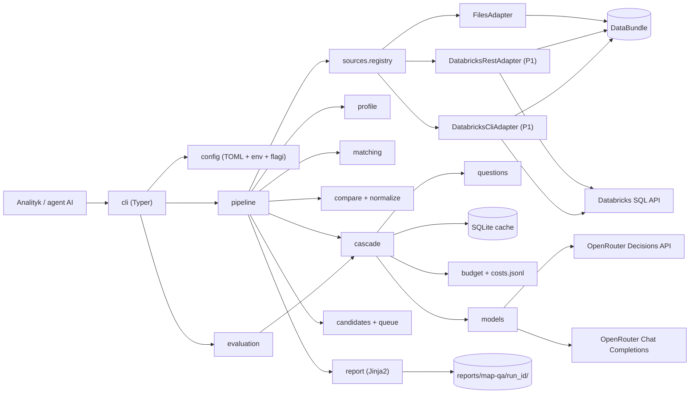
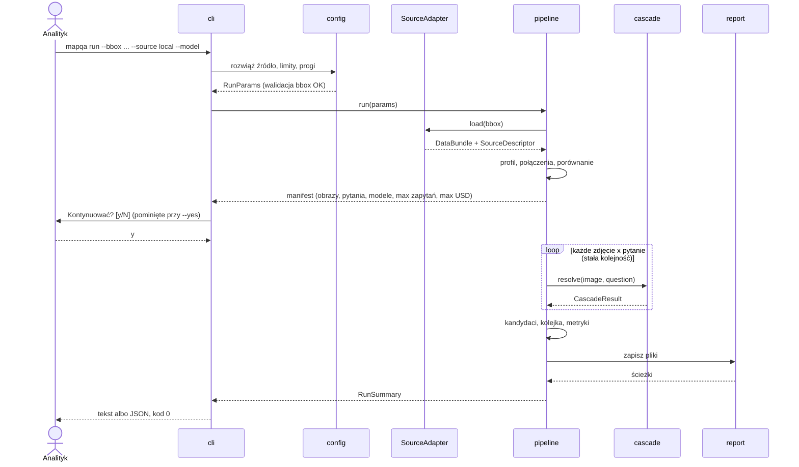
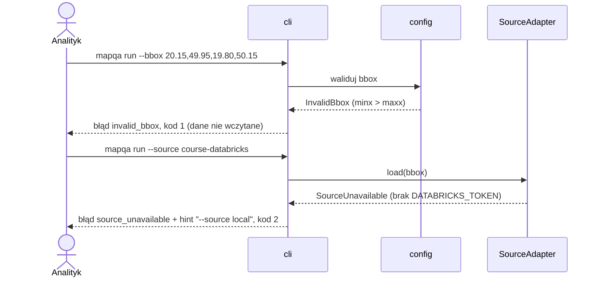
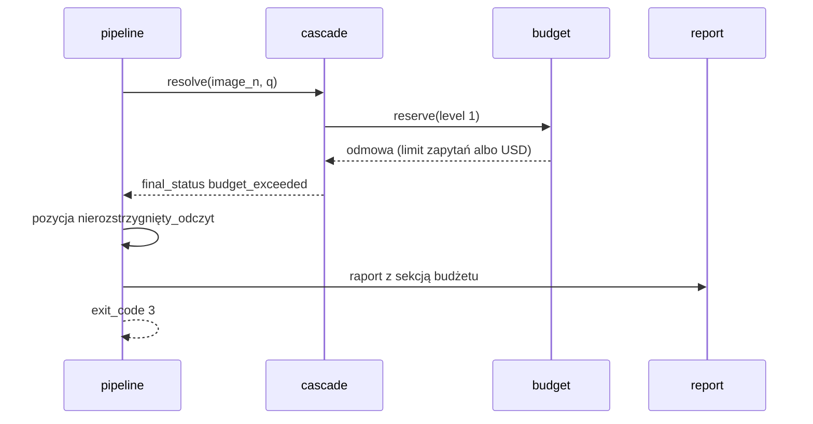

# ADR-000: Map Attribute QA Copilot — architektura główna

**Data:** 2026-11-03
**Status:** Accepted
**PRD:** [`docs/PRD.md`](../PRD.md)
**Powiązane:** [001 — źródła danych](001-data-sources.md), [002 — łączenie przestrzenne i normalizacja](002-spatial-matching-and-normalization.md), [003 — kaskada modeli](003-model-cascade.md), [004 — raport, kolejka i ewaluacja](004-reporting-and-evaluation.md)

---

## 1. Przegląd

Budujemy narzędzie CLI `mapqa` w Pythonie 3.12. Narzędzie wskazuje **kandydatów** do ręcznej weryfikacji atrybutów dróg (ograniczenie prędkości, nawierzchnia, oświetlenie) na podstawie OSM, Overture i zdjęć ulic. Odczyt ze zdjęć wykonuje kaskada: model decyzyjny → zwykły LLM → człowiek. Narzędzie nie rozstrzyga, że mapa jest błędna.

Ten ADR opisuje system jako całość: moduły, kontrakty, technologie i główne decyzje. Szczegóły czterech obszarów są w ADR 001–004. PRD definiuje **co** i **po co**, a ADR-y — **jak** i **dlaczego tak**. W razie konfliktu wymagań biznesowych rozstrzyga PRD; w razie konfliktu technicznego — ADR o wyższym numerze dla swojego obszaru.

Każda decyzja ma oznaczenie zakresu:
- **[MVP]** — wchodzi w pierwszy etap (PRD §9 „Zakres MVP”);
- **[P1]–[P5]** — przyrost 1–5 z PRD §9;
- **[v1]** — docelowe v1 bez przypisanego przyrostu.

Interfejsy (adapter źródła, kontrakt danych, klient modelu) projektujemy od MVP pod docelowe v1, aby przyrosty nie zmieniały kroków F3–F7.

---

## 2. Odniesienia do dokumentacji technologii

Wersje sprawdzone 2026-11-03 (`pip index versions`, PyPI). Identyfikatory Context7 zweryfikowane w tej sesji przez `resolve-library-id` i `query-docs`; gdzie ID nie było sprawdzane, podano oficjalną dokumentację.

| Biblioteka / usługa | Wersja przypięta | Context7 ID albo oficjalna dokumentacja | Zastosowanie |
|---|---|---|---|
| Python | 3.12 (przez uv) | https://docs.python.org/3.12/ | Środowisko uruchomieniowe |
| uv | najnowsza stabilna w chwili instalacji | https://docs.astral.sh/uv/ | Zarządzanie Pythonem, zależnościami, lockfile |
| OpenRouter (Decisions API, Chat Completions) | API `alpha` / `v1` | `/openrouterteam/docs` | Poziom 1 i 2 kaskady, model porównawczy |
| GeoPandas | 1.2.0 | `/geopandas/geopandas` | Wczytanie GeoParquet, CRS, łączenie przestrzenne |
| Shapely | 2.2.0 | https://shapely.readthedocs.io/en/stable/ | Geometria, rzutowanie punktu na linię |
| pyproj | 3.8.0 | https://pyproj4.github.io/pyproj/stable/ | Transformacja EPSG:4326/CRS84 → EPSG:2180 |
| pandas | 3.1.0 | https://pandas.pydata.org/docs/ | Tabele CSV, metryki |
| pyarrow | 26.0.1 | https://arrow.apache.org/docs/python/ | Odczyt Parquet |
| DuckDB (+ spatial) | 2.0.0 | `/websites/duckdb_current` | Tylko narzędzie deweloperskie/profilowe, nie zależność runtime (decyzja D2) |
| Databricks SQL Statement Execution API | REST 2.0 | `/websites/databricks_api` | Adapter `databricks` dostęp `rest` [P1] |
| Databricks CLI | zainstalowana wersja | `/databricks/cli` | Adapter `databricks` dostęp `cli` [P1] |
| httpx | 0.28.1 | https://www.python-httpx.org/ | Klient HTTP OpenRouter i Databricks |
| respx | 0.23.1 | https://lundberg.github.io/respx/ | Mock httpx w testach (z nagranych odpowiedzi) |
| Typer | 0.27.3 | https://typer.tiangolo.com/ | CLI |
| Pydantic | 2.14.2 | https://docs.pydantic.dev/latest/ | Walidacja konfiguracji, modele wyników, JSON |
| Jinja2 | 3.1.6 | https://jinja.palletsprojects.com/en/stable/ | Szablony raportu MD/HTML |
| Pillow | 12.0.0 (świadomie nie 13.0.0) | https://pillow.readthedocs.io/en/stable/ | Przygotowanie obrazu dla modelu, miniatury. Wersja zgodna z danymi kursu: README `exercise-data/map-qa` podaje, że kadry (JPEG q82) i wycinki (JPEG q92) powstały w Pillow 12.0.0, a inna wersja biblioteki JPEG może zmienić bajty przeskalowanego obrazu i dać niezgodny `sha256` (przyjęte za wersją referencyjną prowadzącego) |
| pytest | 9.2.0 | https://docs.pytest.org/en/stable/ | Testy |
| tomllib | stdlib 3.12 | https://docs.python.org/3.12/library/tomllib.html | Odczyt `mapqa.toml` |
| sqlite3 | stdlib 3.12 | https://docs.python.org/3.12/library/sqlite3.html | Cache odpowiedzi modeli |

**Zasada przypinania:** wersje powyżej wpisujemy jako dokładne (`==`) w `app/pyproject.toml` i zatwierdzamy `uv.lock`. Pillow jest wyjątkiem od zasady „najnowsza wersja”: pozostaje 12.0.0 także przy aktualizacji zależności, dopóki dane kursu nie zostaną wygenerowane nowszą wersją. Jeśli `uv lock` nie znajdzie spójnego zestawu (np. pandas 3.1.0 z geopandas 1.2.0), implementujący agent obniża **jedną** bibliotekę (nigdy Pillow) do najnowszej zgodnej wersji, zapisuje przyczynę w sekcji „Odchylenia od ADR” w opisie PR i aktualizuje tę tabelę.

**Ceny modeli (prowadzący, 12.11.2026):** `typesafe/jev-1.14` 0,042 USD / mln tokenów wejścia, wyjście bez opłat, kontekst 262K; `openai/gpt-6-luna-decisions` 0,10 USD / mln tokenów wejścia, wyjście bez opłat, kontekst 1,1M. Cena `openai/gpt-6-luna` i opóźnienia wszystkich modeli są niepotwierdzone. Koszt każdego zapytania odczytujemy z `usage.cost` odpowiedzi (ADR-003).

---

## 3. Architektura systemu

### Wzorzec architektury

**Modularny monolit CLI w układzie porty i adaptery (hexagonal).** Rdzeń pipeline'u (F3–F7) to funkcje i klasy bez I/O sieciowego, operujące na kontrakcie danych (`DataBundle`). Na brzegach są adaptery: źródła danych (files, databricks), klienci modeli (decisions, chat), cache, zapis raportu. Pipeline jest **sekwencyjny i deterministyczny**; jedno uruchomienie = jeden proces.

### Struktura repozytorium

```
app/
  pyproject.toml            projekt uv, entry point `mapqa`, przypięte wersje
  uv.lock
  mapqa.example.toml        przykładowa konfiguracja (kopiowana do mapqa.toml)
  src/mapqa/
    cli/                    Typer: polecenia run, sources, eval; render text/json; kody wyjścia
    config/                 ładowanie TOML + env + flag, precedencja, modele Pydantic
    contract/               DataBundle, schematy zbiorów, walidatory kontraktu
    sources/                port SourceAdapter, files.py, databricks_rest.py [P1], databricks_cli.py [P1], registry
    profile/                profil wejścia (F2.3), odrzucone rekordy
    matching/               łączenie zdjęcie → droga (F3) [P1]; w MVP adapter gotowych dopasowań
    normalize/              normalizacja maxspeed, speed_limits, surface, lit (F4.2)
    compare/                porównanie OSM ↔ Overture (F4.3) [P3]; w MVP tylko OSM
    questions/              katalog pytań, dozwolone odpowiedzi, wersje promptów
    models/                 klienci: decisions_client, chat_client; budowanie żądań; parsowanie
    cascade/                orkiestracja poziomów 1→2→human, progi, ścieżka kaskady
    cache/                  SQLite cache odpowiedzi
    budget/                 licznik zapytań i kosztu, log kosztów JSONL
    candidates/             reguły kandydatów, priorytety, powody po polsku, kolejka (F6)
    evaluation/             podział po sequence, metryki, kalibracja progów (PRD §7)
    report/                 Jinja2: report.md, report.html [P4], manual_queue.csv, evaluation.json
      templates/
    pipeline.py             złożenie kroków F2→F7 dla `mapqa run`
  tests/
    unit/                   testy jednostkowe (wszystkie zależności zastąpione)
    contract/               testy kontraktu adapterów źródeł
    integration/            testy z respx (OpenRouter, Databricks) na nagranych odpowiedziach
    e2e/                    prawdziwe uruchomienie CLI na danych z plików
    fixtures/
      captures/             nagrane prawdziwe odpowiedzi API + metadane nagrania
      data/                 małe syntetyczne GeoDataFrame/CSV i 3–5 obrazów testowych
mapqa.toml                  (opcjonalnie, w katalogu roboczym; ignorowany przez Git, jeśli lokalny)
reports/map-qa/<run_id>/    wyniki uruchomień (ignorowane przez Git)
course-materials/exercise-data/map-qa/data/   cache i pobrane zdjęcia (ignorowane przez Git)
```

Polecenia uruchamiamy z katalogu głównego repozytorium: `uv run --project app mapqa ...`. Ścieżki względne w konfiguracji są rozwiązywane względem katalogu roboczego procesu, nie względem `app/`.

### Stos technologiczny

| Warstwa | Technologia | Uzasadnienie |
|---|---|---|
| Runtime | Python 3.12 + uv | Wymóg PRD §6; uv działa natywnie na Windows bez conda/WSL. |
| CLI | Typer | Podpolecenia, typowane opcje, generowany `--help`; mała zależność na Click. |
| Konfiguracja | tomllib + Pydantic v2 | TOML z PRD F8.2; Pydantic waliduje i daje czytelne błędy z kodem wyjścia 1. |
| Dane przestrzenne | GeoPandas + Shapely + pyproj | Dane mieszczą się w pamięci; łatwe testy jednostkowe na małych ramkach (D2). |
| Dane tabelaryczne | pandas + pyarrow | Standard dla CSV/Parquet, wymagany przez GeoPandas. |
| Źródło zdalne | Databricks SQL Statement Execution API przez httpx; alternatywnie Databricks CLI | PRD F8.3; jeden klient HTTP dla całego projektu (D3). |
| Modele | OpenRouter: Decisions API (poziom 1, porównawczy) i Chat Completions (poziom 2) przez httpx | PRD §3; brak niejawnych ponowień (D4). |
| Cache | SQLite (stdlib) | Jeden plik, atomowe zapisy, brak zależności (D5). |
| Raport | Jinja2 + Pillow | Szablony oddzielone od logiki; miniatury w HTML (D6). |
| Testy | pytest + respx | TDD; mocki z nagranych odpowiedzi (AGENTS.md). |
| UI (poza v1) | Streamlit — rekomendacja na później | D7, status Proposed. |

---

## 4. Struktura modułów i zależności

Kierunek zależności: **cli → pipeline → (rdzeń) → porty ← adaptery**. Rdzeń nie importuje adapterów; adaptery są wybierane w `cli`/`pipeline` przez rejestr na podstawie konfiguracji. Brak zależności cyklicznych; sprawdza to test architektury (TAC-12).

| Moduł | Odpowiedzialność | Zależy od | Używany przez |
|---|---|---|---|
| `cli` | Parsowanie poleceń, wybór formatu wyjścia, potwierdzenie płatnych wywołań (manifest, `y/N`, `--yes`, wykrycie TTY), mapowanie wyjątków domenowych na kody wyjścia | `config`, `pipeline`, `sources.registry`, `evaluation` | użytkownik, agent AI |
| `config` | Precedencja źródła i ustawień, walidacja, rozwiązywanie nazw zmiennych sekretów | stdlib, Pydantic | `cli`, `pipeline` |
| `contract` | Definicja `DataBundle` i schematów zbiorów, walidacja typów/CRS/NULL heading | pandas, GeoPandas | `sources`, `profile`, wszystkie kroki rdzenia |
| `sources` | Port `SourceAdapter` + adaptery `files`, `databricks` | `contract`, httpx, subprocess | `pipeline`, `cli sources` |
| `profile` | Liczności, kompletność tagów z mianownikiem, odrzucone rekordy | `contract` | `pipeline`, `report` |
| `matching` | Zdjęcie → droga, flagi połączenia | `contract`, GeoPandas, Shapely, pyproj | `pipeline` |
| `normalize` | Normalizacja wartości atrybutów z zachowaniem surowych | stdlib | `compare`, `candidates` |
| `compare` | Wynik porównania OSM ↔ Overture | `normalize`, `contract` | `candidates` |
| `questions` | Katalog pytań, dozwolone odpowiedzi, `prompt_version` | stdlib | `models`, `cascade`, `evaluation` |
| `models` | Budowa żądań (tylko obraz + pytanie), wywołanie HTTP, parsowanie, klasyfikacja błędów | httpx, Pillow, `questions` | `cascade` |
| `cache` | Odczyt/zapis odpowiedzi po kluczu | sqlite3 | `cascade` |
| `budget` | Limity zapytań i kosztu, log JSONL | stdlib | `cascade` |
| `cascade` | Orkiestracja poziomów, progi, ścieżka kaskady | `models`, `cache`, `budget`, `questions` | `pipeline`, `evaluation` |
| `candidates` | Reguły F6.1, priorytet F6.3, powód po polsku, kolejka F6.5–F6.7 | `compare`, `normalize`, wynik kaskady, flagi | `pipeline`, `report` |
| `evaluation` | Jedyny czytelnik etykiet (`reference_labels.csv`, `signs/labels.csv`), podział po `sequence`, metryki §7, kalibracja | `cascade`, `questions`, pandas | `cli eval`, `report` |
| `report` | Zapis plików wynikowych | Jinja2, Pillow, `profile`, `candidates`, `evaluation` | `pipeline` |
| `pipeline` | Kolejność kroków F2→F7, tryb bez modelu (domyślny), manifest płatnego odczytu | wszystkie moduły rdzenia + porty | `cli` |

---

## 5. Modele danych

Opis koncepcyjny; dokładne pola zbiorów źródłowych — ADR-001 §4.

| Model | Cel | Kluczowe pola (typ) | Relacje | Trwałość |
|---|---|---|---|---|
| `RunParams` | Parametry uruchomienia | `run_id` (str), `bbox` (4×float, WGS84), `attributes` (lista enum), `source_name` (str), `dataset` (`signs` \| `photos`), `model_reading` (bool, domyślnie `false`), `confirmation` (`interactive` \| `flag_yes` \| `cache_only` \| `declined` \| null), `limits` (`max_queries` int = 100, `max_images` int = 25, `max_usd` decimal = 1.00, `reserve_usd` per rola modelu; ADR-003 §3.6), `models` (per poziom: id, reasoning effort), `thresholds` (per poziom × model × atrybut, float 0–1; ADR-003 §3.5), `seed` (str) | 1 run → wiele wyników | `run.json` w katalogu runu |
| `SourceDescriptor` | Metadane użytego źródła (F7.6) | `name`, `type`, `access`, `tables_or_paths` (lista), `read_started_at`/`read_finished_at` (UTC), `input_hashes` (ścieżka → `sha256` przed runem i po runie, wszystkie przeczytane pliki lokalne: dane, obrazy, etykiety), bez sekretów | 1 run → 1 źródło | `run.json`, raport |
| `DataBundle` | Kontrakt danych z dowolnego źródła | zbiory `osm_roads`, `overture_segments`, `photos`, `photo_road_links`, `traffic_signs`, opcjonalnie `signs`, `sign_nearest_osm`; wszystkie geometrie EPSG:4326; **bez etykiet referencyjnych** (czyta je tylko `evaluation`, ADR-004 §3.10) | produkowany przez adapter | tylko w pamięci |
| `RejectedRecord` | Odrzucony rekord (F2.3) | `dataset`, `record_id`, `reason` (enum: `missing_file`, `hash_mismatch`, `missing_geometry`, `outside_bbox`, `invalid_value`), `detail` (str) | n → 1 run | profil, raport |
| `PhotoRoadLink` | Połączenie zdjęcia z drogą | `photo_id`, `osm_way_id` (int \| null), `overture_id` (str \| null), `distance_m` (float), `heading_diff_deg` (float \| null, 0–90), `candidate_count` (int), `flags` (zbiór enum F3.3), `link_source` (`own` \| `provided`) | 1 zdjęcie → 0..1 link | w pamięci, raport |
| `AttributeValue` | Wartość atrybutu z mapy | `raw` (str/struktura, bez zmian), `normalized` (float km/h, 0,01 \| `paved`/`unpaved`/`unknown_value` \| `yes`/`yes_conditional`/`no`/`unknown_value` \| null), `speed_source` (`explicit` \| `implicit` \| null; `implicit` dla `PL:*`, ADR-002 D-002-4), `status` (`ok`, `missing`, `not_comparable`), `note` (str) | per droga × atrybut × źródło | w pamięci, raport, CSV |
| `ComparisonResult` | OSM ↔ Overture (F4.3) | `attribute`, `osm` (`AttributeValue`), `overture` (`AttributeValue`), `outcome` (enum F4.3), `implicit` (bool — porównanie z wartością `PL:*`), `overture_from_osm` (bool \| null), `overture_release` (str) | per link × atrybut | raport |
| `ModelAttempt` | Jedno wywołanie poziomu | `level` (1 \| 2), `model`, `reasoning_effort` (str \| null), `answer` (str \| null), `probability` (float \| null), `status` (`confident`, `below_threshold`, `invalid_response`, `model_unavailable`, `budget_exceeded`), `cache_hit` (bool), `cost_usd` (decimal \| null), `latency_ms` (int \| null), `error_class` (str \| null; kod HTTP, `timeout`, `connect_error`, `circuit_open`, `max_images`) | 1 `CascadeResult` → 0..2 | cache, log, raport |
| `CascadeResult` | Ścieżka kaskady (F5.7) | `photo_sha256`, `question_id`, `attempts` (lista `ModelAttempt`), `final_status` (`resolved`, `abstain`, `model_unavailable`, `budget_exceeded`, `image_out_of_bounds`, `skipped_no_model`), `resolved_by` (`1`, `2`, `human`), `final_answer` (str \| null), `escalation_reason` (str \| null) | per zdjęcie × pytanie | raport, `evaluation.json` |
| `Candidate` | Kandydat rozbieżności (F6.1) | `attribute`, `rule` (`photo_vs_osm`, `sources_disagree_photo_supports`, `osm_missing_photo_confident`, `sources_only`), `priority` (`wysoki`, `średni`, `niski`), `reason_pl` (str) | link + porównanie + kaskada | raport, CSV |
| `QueueItem` | Pozycja kolejki ręcznej (F6.6) | `item_id` (16 hex), `type` (`nierozstrzygnięty_odczyt`, `kandydat_rozbieżności`), pola F6.6, puste `decyzja`, `wartość_z_terenu`, `komentarz` | 1 kandydat albo 1 nierozstrzygnięta kaskada | `manual_queue.csv` |
| `CacheEntry` | Odpowiedź modelu w cache | klucz (ADR-003 §4), `parsed_answer`, `probability`, `status`, `usage` (tokeny, koszt), `response_body` (JSON bez nagłówków), `created_at` | per klucz | SQLite, bez wygasania w PoC |
| `CostLogEntry` | Wiersz logu kosztów (F5.10) | `ts`, `run_id`, `level`, `model`, `reasoning_effort`, `question_id`, `image_sha256`, `input_tokens`, `output_tokens`, `cost_usd`, `cost_estimated` (bool), `cache` (`hit`/`miss`), `status` | n → 1 run | `costs.jsonl` |
| `EvaluationReport` | Metryki §7 | per pytanie i podgrupa: mianowniki, trafność, eskalacja, przekazanie człowiekowi, pokrycie; per poziom; baseline detektora Mapillary; `split` (`calibration` \| `test`) | 1 run → 1 | `evaluation.json`, raport |

---

## 6. Kontrakty interfejsów (CLI)

Wszystkie polecenia przyjmują `--config <ścieżka>` i `--output text|json` (domyślnie `text`). Przy `--output json` stdout zawiera **wyłącznie** jeden dokument JSON (koperta poniżej); komunikaty diagnostyczne idą na stderr.

**Koperta JSON:** `ok` (bool), `command` (str), `exit_code` (int), `result` (obiekt, gdy `ok`), `error` (obiekt `code` — stały identyfikator np. `invalid_bbox`, `unknown_source`, `source_unavailable`, `auth_failed`, `budget_exceeded`, `confirmation_required`, `input_modified`; `message` — po polsku; `hint` — sugestia alternatywy, np. inne źródło), `warnings` (lista str).

**Kody wyjścia (F8.9):** `0` sukces (także po odmowie `N` w potwierdzeniu — raport bez odczytu modelem); `1` błąd danych/walidacji (bbox, konfiguracja, nieznane źródło, naruszenie kontraktu, `confirmation_required`: włączony odczyt modelem bez TTY i bez `--yes`); `2` źródło niedostępne lub brak uprawnień (brak tokenu, 401/403, timeout połączenia, `FAILED` zapytania z błędem uprawnień); `3` run **zakończony** z raportem, ale odczyt modelem jest niepełny: co najmniej jedno pytanie dostało `budget_exceeded` albo bezpiecznik API się otworzył (`model_unavailable` z błędem API lub `circuit_open`; ADR-003 §3.5) (D10-I6); `4` pliki wejściowe zmieniły się w trakcie runu (`input_modified`; nowy kod 2026-11-12, D12).

Kolejność: `1` i `2` przerywają run przed zapisem raportu (`ok=false`, brak `result`). `4` jest sprawdzany na końcu, po zapisie raportu: pipeline liczy `sha256` wszystkich przeczytanych plików wejściowych przed odczytem i ponownie po zapisie wyników; jakakolwiek różnica, brak pliku albo nowy plik w zbiorze wejść → `ok=false`, `error.code = input_modified`, `error.message` z listą zmienionych ścieżek, kod 4 (ma pierwszeństwo przed 3). Raport zostaje na dysku, ale nagłówek `report.md` i `run.json` oznacza go jako niewiarygodny. `3` występuje tylko po pełnym zapisie raportu: `ok=true`, `result` kompletny, `warnings` zawiera `budget_exceeded: N pytań` i/lub `circuit_open: <kod błędu>, N pytań`. Agent nie powinien ponawiać runu z kodem 3 bez decyzji człowieka (zmiana limitów albo ustąpienie awarii API) — ponowny run wysyła zapytania tylko dla pytań, których nie ma w cache.

| Polecenie | Wejście | Wyjście (`result`) | Błędy |
|---|---|---|---|
| `mapqa run` | `--bbox minx,miny,maxx,maxy` (domyślnie `19.80,49.95,20.15,50.15` dla `--dataset photos`; dla `--dataset signs` domyślnie brak filtra bbox — D10-I2), `--attributes speed_limit,surface,lit`, `--source <nazwa>`, `--dataset signs\|photos` (MVP: `signs`), `--model` (włącza płatny odczyt; domyślnie wyłączony — D11), `--no-model` (wymusza tryb bez modelu mimo `model_reading = true`), `--yes` (potwierdza manifest bez pytania), `--max-queries N` (100), `--max-images N` (25), `--max-usd X` (1.00), `--level1-model`, `--level2-model`, `--level2-effort`, `--threshold-l1`, `--threshold-l2` (nadpisują wszystkie atrybuty dla bieżącego modelu danego poziomu), `--split all\|calibration\|test` | `run_id`, `output_dir`, ścieżki plików, `model_reading`, `confirmation`, manifest kosztu, liczności lejka kaskady, liczba kandydatów per atrybut/priorytet, koszt per poziom, liczba `budget_exceeded` | 1: niepoprawny bbox (odwrócone granice, lon ∉ [-180,180], lat ∉ [-90,90]), nieznany atrybut, nieznane źródło (z listą dostępnych), `confirmation_required`; 2: źródło niedostępne; 3: budżet albo bezpiecznik API; 4: wejście zmienione w trakcie runu |
| `mapqa sources list` | — | lista `{name, type, access, is_default, resolved_by}` gdzie `resolved_by` ∈ `flag`, `env`, `config`, `builtin` | 1: niepoprawny plik konfiguracyjny |
| `mapqa sources check` | `--source`, `--bbox` | `{name, reachable, tables: {nazwa: {total, in_bbox}}, warnings}` | 1: nieznane źródło; 2: brak dostępu |
| `mapqa eval run` | jak `run`, domyślnie `--split test`; odczyt modelem zawsze włączony, więc zawsze obowiązuje potwierdzenie manifestu (`y/N` albo `--yes`) | `EvaluationReport` + ścieżka `evaluation.json` | jak `run` |
| `mapqa eval calibrate` | `--split calibration`, `--target-accuracy 0.90`, `--grid 0.50:0.99:0.01` | proponowane progi per poziom × model × atrybut, plik `calibration.json` | jak `run` |

Polecenia `eval` korzystają z tej samej kaskady, cache, budżetu i potwierdzenia co `run` (ADR-004).

**Potwierdzenie płatnych wywołań (D11):** przy `--model` (albo w `eval`) i co najmniej jednym pytaniu bez trafienia w cache CLI wypisuje manifest (liczba obrazów i pytań, modele per poziom, `max_queries`, `max_usd`) — przy `--output text` na stdout, przy `--output json` na stderr — i czeka na `y/N`. `--yes` pomija pytanie. Stdin bez TTY i brak `--yes` → kod 1, `error.code = confirmation_required`, `hint` = „dodaj `--yes` albo uruchom bez `--model`”, brak raportu, 0 zapytań. Odpowiedź `N` → raport bez odczytu modelem (`skipped_no_model`), `warnings` zawiera `model_reading_declined`, kod 0.

---

## 7. Zmienne środowiskowe

| Zmienna | Cel | Wymagana | Przykład |
|---|---|---|---|
| `OPENROUTER_API_KEY` | Klucz OpenRouter (poziom 1, 2, model porównawczy) | Tak, gdy run wywołuje modele (`--model`, `eval`); nie w domyślnym trybie bez modelu | `sk-or-…` (nigdy w repo) |
| `DECISION_MODEL` | Domyślny model decyzyjny poziomu 1, jeśli nie ustawiono go w konfiguracji/flagą (D9) | Nie | `typesafe/jev-1.14` |
| `LLM_MODEL` | Domyślny model poziomu 2, jeśli nie ustawiono go w konfiguracji/flagą | Nie | `openai/gpt-6-luna` |
| `MAPQA_SOURCE` | Wybór źródła (precedencja F8.1 poz. 2) | Nie | `course-databricks` |
| `MAPQA_CONFIG` | Ścieżka pliku konfiguracyjnego | Nie | `C:\work\mapqa.toml` |
| `DATABRICKS_HOST` | Host workspace (nazwa zmiennej konfigurowalna przez `host_env`) | Tak dla źródła `databricks` | `https://dbc-xxxx.cloud.databricks.com` |
| `DATABRICKS_TOKEN` | Token SQL (konfigurowalne przez `token_env`) | Tak dla `databricks` dostęp `rest` | `dapi…` (nigdy w repo) |
| `DATABRICKS_SQL_WAREHOUSE_ID` | ID warehouse (konfigurowalne przez `warehouse_id_env`) | Tak dla `databricks` | `abcdef1234567890` |

Wartości sekretów są odczytywane wyłącznie w momencie budowy klienta HTTP i nie są przechowywane w obiektach konfiguracji, logach, cache, raporcie ani komunikatach błędów (F1.5, F8.8; ADR-001 §6 D-001-5).

---

## 8. Decyzje techniczne

### D1. Modularny monolit CLI z portami i adapterami
**Status:** Accepted
**Data:** 2026-11-03
**Kontekst:** PRD wymaga wymiennych źródeł (F8.4), trybu bez modelu (F1.4) i testów z mockami API. Kroki F3–F7 mają nie zależeć od źródła ani od dostawcy modelu.
**Decyzja:** Jeden pakiet `mapqa` z rdzeniem bez I/O sieciowego i adapterami na brzegach (źródła, klienci modeli, cache, raport). Adapter wybiera rejestr na podstawie konfiguracji.
**Odrzucone alternatywy:**
- Skrypty per krok (notebooki/pliki .py): brak wspólnego kontraktu, trudne testy end-to-end i kody wyjścia.
- Serwis HTTP/MCP: poza zakresem v1 (PRD §3); CLI z `--output json` przygotowuje grunt.
**Konsekwencje:**
- (+) Nowe źródło = nowy adapter + wpis w rejestrze; testy kontraktowe wspólne dla adapterów.
- (+) Rdzeń testowalny jednostkowo bez sieci.
- (-) Więcej warstw niż w prostym skrypcie; wymaga dyscypliny importów (test architektury).
**Warunek rewizji:** Gdy narzędzie ma działać jako długotrwały serwis (MCP, dashboard) obsługujący równoległe żądania.

### D2. GeoPandas + Shapely + pyproj zamiast DuckDB spatial w pipeline
**Status:** Accepted
**Data:** 2026-11-03
**Kontekst:** F3 wymaga dystansów w EPSG:2180, kandydatów w promieniu 25 m, lokalnego kierunku drogi i flag; dane to ~100 tys. dróg OSM, ~85 tys. segmentów Overture i 561 zdjęć (+119 znaków). Porównaliśmy dwa silniki.
**Decyzja:** GeoPandas 1.2.0 (`to_crs`, `sindex.query` z `predicate="dwithin"`, `sjoin_nearest` z `max_distance`/`distance_col`), Shapely 2.2.0 (rzutowanie na linię, styczna), pyproj 3.8.0. DuckDB 2.0.0 nie jest zależnością runtime; pozostaje narzędziem do profilowania (`profile.sql` w materiałach) i ad-hoc analiz.
**Odrzucone alternatywy:**
- DuckDB spatial (`ST_Transform(..., always_xy := true)`, `ST_DWithin`): szybki dla dużych zbiorów i zapytań SQL, ale lokalny kierunek drogi, remisy i flagi wymagają logiki proceduralnej, której test jednostkowy w SQL jest trudniejszy; pułapka osi lat/lon dla EPSG:4326 bez `always_xy`; rozszerzenie spatial nie jest autoładowane i pierwsza instalacja wymaga internetu.
- Shapely + pyproj bez GeoPandas: brak indeksu przestrzennego na ramkach i odczytu GeoParquet; więcej własnego kodu.
**Konsekwencje:**
- (+) Testy na małych GeoDataFrame z ręcznie policzonymi oczekiwaniami; jeden język logiki.
- (+) `to_crs` w GeoPandas używa kolejności osi x/y (lon/lat) dla GeoParquet.
- (-) Całe zbiory w pamięci (~kilkaset MB); akceptowalne na maszynie 16 GB.
- (-) Filtr bbox po stronie źródła `files` odbywa się po wczytaniu (ADR-001).
**Warunek rewizji:** Gdy `--no-model` na pełnym bbox przekracza 2 min (PRD §6) albo dane rosną > 1 mln dróg.

### D3. Databricks przez SQL Statement Execution API (httpx) i opcjonalnie CLI; bez SDK i MCP
**Status:** Accepted
**Data:** 2026-11-03
**Kontekst:** PRD F8.3 wymaga dostępu `rest` i `cli`, F8.7 precyzuje obsługę stanów i chunków. Lokalne GeoParquet jest źródłem domyślnym i punktem odniesienia.
**Decyzja:** Źródło domyślne `files` [MVP]. Adapter `databricks` [P1] z dostępem `rest` (httpx, `POST /api/2.0/sql/statements`, odpytywanie, chunki) oraz `cli` (subprocess `databricks api post /api/2.0/sql/statements`). Szczegóły ADR-001.
**Odrzucone alternatywy:**
- `databricks-sdk` (0.160.0): duża zależność, własne mechanizmy ponowień, które kolidują z F8.7 („zapytanie, które może nadal działać, nie jest automatycznie ponawiane”).
- `databricks-sql-connector`: protokół Thrift/Arrow zamiast wymaganego przez PRD REST/CLI; trudniejszy mock z nagrania HTTP.
- Databricks Managed MCP: poza zakresem v1 (PRD §3).
**Konsekwencje:**
- (+) Jeden klient HTTP w projekcie; mock z nagranej odpowiedzi przez respx.
- (-) Własna implementacja odpytywania i chunków (mała, dobrze opisana w dokumentacji).
**Warunek rewizji:** Gdy potrzebny będzie OAuth M2M/U2M zamiast tokenu PAT albo wyniki > 25 MiB wymagające `EXTERNAL_LINKS`.

### D4. Klient OpenRouter: surowe httpx zamiast oficjalnego SDK; brak automatycznych ponowień
**Status:** Accepted
**Data:** 2026-11-03
**Kontekst:** Poziom 1 i model porównawczy używają `POST https://openrouter.ai/api/alpha/decisions`; poziom 2 — `POST https://openrouter.ai/api/v1/chat/completions`. PRD wymaga kontroli budżetu per zapytanie, timeoutu i braku ponowień (budżet zjadany przez retry); pierwszy błąd API otwiera bezpiecznik do końca runu (ADR-003 D-003-3). Natywny klient OpenAI jest wykluczony przez prompt ćwiczenia.
**Decyzja:** Jeden moduł `models` z `httpx.Client` (timeout konfigurowalny, domyślnie 60 s; transport bez ponowień), osobne budowniczne żądań dla Decisions i Chat. Każde wywołanie HTTP = jedno zapytanie w budżecie.
**Odrzucone alternatywy:**
- Oficjalne SDK `openrouter` 1.3.107 (`client.alpha.decisions.create`): API jest `alpha`, a dokumentacja nie opisuje domyślnych ponowień — parametr `retries` istnieje, ale bez udokumentowanych pól; ryzyko niejawnych ponowień i zmian sygnatur w kolejnych wydaniach.
- Natywny klient OpenAI z `base_url`: wykluczony; nie obsługuje Decisions API.
**Konsekwencje:**
- (+) Pełna kontrola nad payloadem (`reasoning`, `response_format`, `assets`), nagłówkami i liczeniem zapytań.
- (+) Mock 1:1 z nagranej odpowiedzi HTTP.
- (-) Ręczne modele odpowiedzi; zmiany API `alpha` wymagają aktualizacji parsera (wykrywa je `invalid_response` i testy kontraktowe nagrań).
**Warunek rewizji:** Gdy Decisions API wyjdzie z `alpha`, a SDK udokumentuje wyłączanie ponowień.

### D5. Cache w SQLite, log kosztów w JSONL
**Status:** Accepted
**Data:** 2026-11-03
**Kontekst:** F5.8 wymaga cache po kluczu z hashem obrazu, pytaniem, modelem, effort i wersją promptu, osobno per poziom; NFR: ponowny run = 0 USD. F5.10 wymaga logu JSONL.
**Decyzja:** Plik `course-materials/exercise-data/map-qa/data/cache/llm_cache.sqlite` (katalog ignorowany przez Git, F2.2), jedna tabela z kluczem złożonym; log kosztów `reports/map-qa/<run_id>/costs.jsonl`. Szczegóły ADR-003 §4.
**Odrzucone alternatywy:**
- Plik JSON per klucz: tysiące plików, brak atomowości na Windows, trudniejsze statystyki.
- DuckDB jako cache: niepotrzebna zależność runtime (D2).
**Konsekwencje:**
- (+) Atomowe zapisy, zapytania diagnostyczne SQL, zero zależności.
- (-) Jeden proces pisze naraz (wystarcza przy sekwencyjnym pipeline).
**Warunek rewizji:** Gdy runy będą równoległe lub cache współdzielony między maszynami.

### D6. Raport z szablonów Jinja2
**Status:** Accepted
**Data:** 2026-11-03
**Kontekst:** F7 wymaga `report.md` [MVP] i samodzielnego `report.html` z miniaturami [P4], z tekstami po polsku i stałą strukturą sekcji.
**Decyzja:** Jinja2 3.1.6, szablony w `report/templates/`, autoescape włączony dla HTML; logika (liczenie, sortowanie) w Pythonie, szablon tylko formatuje. Miniatury przez Pillow, osadzone base64 (ADR-004).
**Odrzucone alternatywy:**
- Czysty Python (f-stringi): miesza logikę z prezentacją, trudny przegląd treści po polsku, brak autoescape w HTML.
- Generator raportów (np. Quarto, Datapane): dodatkowe środowisko uruchomieniowe, poza wymaganiami.
**Konsekwencje:**
- (+) Treść raportu edytowalna bez zmian w logice; testy snapshot na wyrenderowanym tekście.
- (-) Dodatkowa zależność (mała, stabilna).
**Warunek rewizji:** Gdy raport zostanie zastąpiony dashboardem (D7).

### D7. Dashboard (poza v1): Streamlit zamiast PySide6 — rekomendacja na później
**Status:** Proposed
**Data:** 2026-11-03
**Kontekst:** PRD §3 „Poza zakresem v1” wymienia dashboard z mapą i przyciskami decyzji (Streamlit albo PySide6). Decyzję zapisujemy, aby v1 nie zamknął drogi.
**Decyzja:** Gdy dashboard wejdzie w zakres — Streamlit, czytający `manual_queue.csv` i `run.json` z katalogu runu (bez zmian w pipeline).
**Odrzucone alternatywy:**
- PySide6: natywna aplikacja desktopowa, większy koszt UI i dystrybucji na Windows; lepsza tylko przy pracy offline z dużymi rastrami.
**Konsekwencje:**
- (+) Szybki prototyp w przeglądarce, ten sam Python.
- (-) Wymaga osobnego procesu serwera; zapis decyzji to nowy kontrakt.
**Warunek rewizji:** Przy włączeniu dashboardu do zakresu (nowy ADR).

### D8. Wykonanie sekwencyjne
**Status:** Accepted
**Data:** 2026-11-03
**Kontekst:** MVP to 119 wycinków, limit 100 zapytań i 25 nowych obrazów na run; budżet musi być deterministyczny, a cache spójny.
**Decyzja:** Pytania do modeli wykonywane kolejno w stałej kolejności (sortowanie po `photo_id`, potem `question_id`). Brak asyncio i puli wątków.
**Odrzucone alternatywy:**
- asyncio z semaforem: szybciej, ale rezerwacja budżetu i kolejność wpisów w cache/logu stają się niedeterministyczne.
**Konsekwencje:**
- (+) Powtarzalne wyniki i log; proste testy budżetu (kryterium 9).
- (-) Pełny run na zimnym cache trwa dłużej (szacunek: 119 × 1–3 s ≈ 2–6 min dla poziomu 1).
**Warunek rewizji:** Gdy zimny run przekroczy 15 min albo liczba zdjęć wzrośnie > 1000.

### D9. Model decyzyjny poziomu 1: `typesafe/jev-1.14`; `openai/gpt-6-luna-decisions` jako alternatywa i model porównawczy
**Status:** Accepted
**Data:** 2026-11-03, zmieniona 2026-11-12
**Kontekst:** Pierwotnie (2026-11-03) poziom 1 = `openai/gpt-6-luna-decisions`, a `typesafe/jev-1.14` służył tylko do porównań, bo cennik obu modeli był niepotwierdzony (strony modeli zwracały HTTP 404). 12.11.2026 prowadzący wskazał `typesafe/jev-1.14` jako model decyzyjny, a `openai/gpt-6-luna-decisions` jako opcjonalną alternatywę. Podał też ceny: Jev 0,042 USD/mln tokenów wejścia, wyjście 0 USD, kontekst 262K; Luna decisions 0,10 USD/mln tokenów wejścia, wyjście 0 USD, kontekst 1,1M. Oba modele przyjmują obrazy (OpenRouter „Multimodal Decisions”).
**Decyzja:** Poziom 1 = `typesafe/jev-1.14` (PRD §3), model wybierany konfiguracją: `models.level1` > `DECISION_MODEL` > domyślny. Tryb porównawczy (F5.11) domyślnie uruchamia `openai/gpt-6-luna-decisions`. Pytania jako typ `choice` (prędkość: 14 opcji; nawierzchnia, oświetlenie: 3 opcje), pewność = `max(probabilities)` po walidacji odpowiedzi (ADR-003 §3.4; zmienione 2026-11-12). Przed implementacją klienta nagrywamy jedną prawdziwą odpowiedź każdego modelu (ADR-003 D-003-6). Nagranie potwierdza realny koszt zapytania z obrazem i format odpowiedzi.
**Odrzucone alternatywy:**
- `openai/gpt-6-luna-decisions` na poziomie 1 jako domyślny: ~2,4× droższe wejście (obrazy to głównie tokeny wejścia), a prowadzący wskazał Jev. Pozostaje dostępny przez konfigurację.
- Typ pytania `noul` dla oświetlenia: nie obsługuje trzeciej odpowiedzi `nie widać` wymaganej przez F5.2.
**Konsekwencje:**
- (+) Jednolity kontrakt dla wszystkich atrybutów (`choice`).
- (+) Niższy koszt poziomu 1. Oba modele decyzyjne mają ten sam kontrakt Decisions API, więc zamiana to tylko zmiana konfiguracji.
- (-) Ceny pochodzą od prowadzącego, a nie z nagrania. Do czasu nagrania budżet chroni rezerwacja (ADR-003).
**Warunek rewizji:** Gdy na zbiorze kalibracyjnym `openai/gpt-6-luna-decisions` osiągnie trafność wyższą o ≥ 5 p.p. przy akceptowalnym koszcie albo Jev wyraźnie częściej eskaluje do poziomu 2. Wtedy domyślny model poziomu 1 się zmienia (nowy wpis ADR).

### D10. Techniczne interpretacje niejednoznaczności PRD (do zatwierdzenia w PRD)
**Status:** Proposed — obowiązuje implementację, dopóki PRD nie zostanie zaktualizowany inaczej
**Data:** 2026-11-03
**Kontekst:** Code review PRD (PR #1 w forku, `/code-review medium`) wykazał sprzeczności i luki, które blokują jednoznaczne testy. Rozstrzygnięcia są techniczne; decyzja produktowa należy do właściciela PRD.
**Decyzja:**
- **I1 — odpowiedzi bez wartości (F6.1):** pewne odczyty `brak znaku`, `nieczytelny`, `nie widać` **nie** tworzą kandydata rozbieżności (brak znaku w kadrze nie przeczy `maxspeed`). Liczą się do metryk ewaluacji (§7) jako odpowiedzi. Szczegóły ADR-004.
- **I2 — bbox a zestaw `signs/` (§9):** 24 ze 119 wycinków leży poza bbox Krakowa (Warszawa, Poznań, Gdańsk, Wrocław, Łódź). Dla `--dataset signs` bbox domyślnie nie filtruje; jawne `--bbox` filtruje jak zwykle. Dzięki temu ewaluacja MVP obejmuje 115 etykiet `certain`.
- **I3 — priorytet `niski` (F6.3):** dodajemy regułę `sources_only`: OSM i Overture się różnią, a kaskada nie dała pewnego odczytu wartości → kandydat `niski`. Aktywna od [P3] (porównanie z Overture).
- **I4 — odsetek przekazania człowiekowi (§7):** licznik = pytania z etykietą `certain` i końcowym statusem `abstain`, `model_unavailable`, `budget_exceeded` albo `image_out_of_bounds`, niezależnie od tego, czy powstała pozycja kolejki. „Wynik ma znaczenie” (F6.5) = zdjęcie ma połączenie z drogą OSM (`osm_way_id` nie null) — tylko wtedy powstaje pozycja `nierozstrzygnięty_odczyt`.
- **I5 — budżet a model porównawczy (F5.9 vs F5.11):** wywołania modelu porównawczego (domyślnie `openai/gpt-6-luna-decisions`) liczą się do wspólnego limitu runu. Tryb porównawczy jest domyślnie wyłączony; kryterium 9 testujemy bez niego.
- **I6 — kod `3` (F8.9 vs F5.9):** kod 3 oznacza run zakończony z raportem i niepełnym odczytem: co najmniej jedno `budget_exceeded` albo otwarty bezpiecznik API (§6, ADR-003 §3.5; rozszerzone 2026-11-12). Wersja referencyjna prowadzącego zwraca w tej sytuacji 0; zachowujemy 3, aby agent odróżnił run z pełnym odczytem.
- **I7 — nazwy a typy źródeł (F1.3, F8.1):** zawsze istnieje wbudowane źródło o **nazwie** `files` (typ `files`, `path` = katalog danych kursu), chyba że plik konfiguracyjny definiuje własne źródło o tej nazwie. `databricks` nie jest nazwą wbudowaną — źródło Databricks istnieje tylko jako wpis w konfiguracji (np. `course-databricks`). `--source databricks` bez takiego wpisu = `unknown_source`, kod 1.
**Odrzucone alternatywy:**
- Implementacja dosłowna PRD: I1 zalałaby kolejkę fałszywymi kandydatami (każda klatka bez znaku), I2 zmniejszyłaby zbiór ewaluacyjny o 21%, I4 zaniżałaby metrykę akceptacji.
**Konsekwencje:**
- (+) Testy i kryteria akceptacji są jednoznaczne.
- (-) PRD wymaga aktualizacji sekcji F1.3, F5.9/F5.11, F6.1, F6.3, F8.1, F8.9, §7 i §9.
**Warunek rewizji:** Aktualizacja PRD przez właściciela produktu; wtedy D10 zmienia status na Superseded dla zmienionych punktów.

### D11. Płatne wywołania modeli domyślnie wyłączone, potwierdzenie manifestu
**Status:** Accepted
**Data:** 2026-11-12
**Kontekst:** Narzędzie uruchamia także agent AI. Pierwotnie (2026-11-03) odczyt modelem był domyślny, a `--no-model` go wyłączał, więc przypadkowe uruchomienie zużywało budżet OpenRouter. Wersja referencyjna prowadzącego (PRD §4.2 pkt 2, ADR-004 §3.3, D-43) domyślnie wyłącza odczyt i wymaga potwierdzenia.
**Decyzja:** `model_reading = false` domyślnie; `--model` włącza odczyt, `--no-model` wymusza tryb bez modelu. Przed pierwszym płatnym wywołaniem CLI pokazuje manifest i pyta `y/N`; `--yes` potwierdza nieinteraktywnie; brak TTY bez `--yes` → kod 1 `confirmation_required`; odmowa `N` → raport bez odczytu, kod 0 (§6). Przyjęte za wersją referencyjną prowadzącego; kod 1 zamiast osobnego kodu, bo to błąd walidacji wywołania wykryty przed wydaniem pieniędzy (istniejący schemat kodów z §6).
**Odrzucone alternatywy:**
- Odczyt domyślnie włączony z `--no-model`: agent lub skrypt wydaje pieniądze przez pominięcie flagi.
- Brak TTY traktowany jak odmowa `N` (kod 0): agent nie zauważyłby, że odczyt się nie odbył.
**Konsekwencje:**
- (+) Uruchomienie bez flag nigdy nie kosztuje; agent musi jawnie podać `--model --yes`.
- (-) Dwie flagi więcej przy płatnym runie; testy E2E `paid` podają `--model --yes`.
**Warunek rewizji:** Gdy narzędzie dostanie budżet produkcyjny z rozliczaniem per użytkownik.

### D12. Kontrola niezmienności wejść i kod wyjścia 4
**Status:** Accepted
**Data:** 2026-11-12
**Kontekst:** PRD F2.2 wymaga, aby pliki wejściowe były tylko do odczytu. Test FIL-06 (ADR-001) sprawdza to raz, ale nie chroni pojedynczego runu przed zmianą danych przez inny proces (np. `download_photos.py` uruchomiony równolegle). Wersja referencyjna prowadzącego (ADR-000 D-05, ADR-004 §5) liczy `sha256` wejść przed i po runie i zwraca osobny kod.
**Decyzja:** Pipeline liczy `sha256` wszystkich przeczytanych plików lokalnych (dane, obrazy, etykiety) przed odczytem i po zapisie wyników; różnica → kod **4** `input_modified` (nowy kod dopisany do schematu §6 bez zmiany numeracji 0–3), raport oznaczony jako niewiarygodny. Hashe trafiają do `run.json`. Przyjęte za wersją referencyjną prowadzącego (tam kod 5; u nas 4, bo nasz schemat ma kody 0–3).
**Odrzucone alternatywy:**
- Kod 1 (błąd danych): agent nie odróżniłby zmiany danych w trakcie runu od błędnego wywołania.
- Kontrola tylko mtime: tańsza, ale nie wykrywa zmiany z zachowanym czasem modyfikacji.
**Konsekwencje:**
- (+) Raport zawsze odpowiada danym, które istniały przez cały run; ślad hashy w `run.json`.
- (-) Dwukrotne hashowanie ~800 obrazów i ~25 MB danych (szacunek: kilka sekund, wliczone w limit 2 min PRD §6).
**Warunek rewizji:** Gdy źródłem będą wyłącznie dane zdalne bez plików lokalnych albo hashowanie przekroczy 10% czasu runu.

---

## 9. Diagramy

### 9.1 Diagram komponentów



### 9.2 Przepływ danych

```mermaid
flowchart TD
  A["Źródło: pliki albo Databricks"] -->|"DataBundle EPSG:4326"| B["Profil wejścia F2"]
  B -->|"odrzucone rekordy z przyczyną"| R["Raport"]
  B --> C["Połączenie zdjęcie-droga F3 (EPSG:2180)"]
  C -->|"PhotoRoadLink + flagi"| D["Normalizacja i porównanie OSM-Overture F4"]
  C -->|"bajty obrazu + pytanie"| E["Kaskada F5"]
  E -->|"CascadeResult"| F["Kandydaci i kolejka F6"]
  D -->|"ComparisonResult"| F
  F --> R
  E --> G["Ewaluacja §7 (etykiety certain)"]
  G --> R
  R --> O1["report.md"]
  R --> O2["report.html (P4)"]
  R --> O3["manual_queue.csv"]
  R --> O4["evaluation.json"]
  E --> O5["costs.jsonl"]
  E <--> K[("cache SQLite")]
```



### 9.3 Diagramy sekwencji

#### `mapqa run` — ścieżka szczęśliwa (z modelem)



#### `mapqa run` — błąd walidacji i niedostępne źródło



#### `mapqa run` — przekroczony budżet



---

## 10. Strategia testów

### Filozofia

TDD zgodnie z AGENTS.md: test przed kodem, potwierdzony czerwony wynik z oczekiwanego powodu, minimalna implementacja, refaktoryzacja przy zielonych testach. Mocki API powstają **wyłącznie** z nagranych prawdziwych odpowiedzi (`tests/fixtures/captures/`, metadane: data, endpoint, model, opis żądania bez sekretów). Każdy etap (MVP, P1–P5) kończy się prawdziwym uruchomieniem CLI na danych z plików i ręczną kontrolą wyjścia.

### Warstwy testów

| Warstwa | Typ | Zakres | Narzędzia |
|---|---|---|---|
| Unit | Logika czysta | normalizacja, bbox, precedencja konfiguracji, flagi, reguły kandydatów, priorytety, id kolejki, metryki, podział po sequence, budżet, klucz cache, parsowanie odpowiedzi | pytest, małe GeoDataFrame, `tmp_path` |
| Contract | Adaptery źródeł | ten sam zestaw testów dla `files` i `databricks` (nagranie) | pytest parametryzowany po adapterze |
| Integration | Brzegi HTTP | OpenRouter Decisions/Chat, Databricks REST — przez respx z nagrań; SQLite cache na dysku tymczasowym | pytest, respx |
| E2E | Prawdziwy stos | `uv run --project app mapqa run --no-model` na plikach; jedno płatne uruchomienie z limitem | subprocess, pytest marker `e2e`, `paid` |
| Manual QA | CLI | odczyt `report.md`, `manual_queue.csv`, `--output json` | terminal |

Markery pytest: `e2e` (wolne, na prawdziwych danych), `paid` (wywołuje płatne API; nigdy domyślnie). Domyślny `uv run --project app pytest` uruchamia unit + contract + integration.

### Kluczowe scenariusze

Szczegółowe tabele scenariuszy są w ADR 001–004. Scenariusze przekrojowe:

| Scenariusz | Wejście | Oczekiwany wynik | Przypadki brzegowe |
|---|---|---|---|
| Niepoprawny bbox | `20.15,49.95,19.80,50.15`; `19.8,95,20,96` | kod 1, `invalid_bbox`, brak odczytu danych (adapter nie wywołany) | bbox o zerowej szerokości; spacje w argumencie |
| Precedencja źródła | flaga + env + config | `--source` > `MAPQA_SOURCE` > `default_source` > `files` | nieznana nazwa → kod 1 i lista nazw |
| Tryb bez modelu (domyślny i `--no-model`) | dane z plików, bez `--model` | brak wywołań HTTP (respx bez tras, `assert_all_called=False`, każde żądanie = błąd testu), raport powstaje | brak `OPENROUTER_API_KEY` nie jest błędem |
| Potwierdzenie płatnych wywołań | `--model` bez cache: (a) TTY + `y`, (b) TTY + `N`, (c) stdin bez TTY bez `--yes`, (d) `--yes` | (a) i (d) odczyt modelem, manifest przed 1. żądaniem; (b) raport bez odczytu, kod 0, `model_reading_declined`; (c) kod 1, `confirmation_required`, 0 żądań, brak raportu | pełne pokrycie z cache → brak pytania; `--output json` → manifest na stderr, stdout tylko JSON |
| Koperta JSON | `--output json` dla każdego polecenia | stdout parsuje się jako jeden obiekt JSON z polami koperty | błąd → `ok=false`, `error.code` |
| Niezmienność wejść | run na kopii danych; wariant z plikiem zmienionym przez hook testowy w trakcie runu | bez zmiany: `sha256` przed = po, kod 0; ze zmianą: kod 4, `input_modified`, lista ścieżek | usunięty plik obrazu w trakcie runu → kod 4 |
| Sekrety | env z fałszywymi tokenami o znanym wzorcu | wzorzec nie występuje w stdout, stderr, logach, cache, raportach | wyjątek z httpx zawierający nagłówki |

### Techniczne kryteria akceptacji

- TAC-01: `uv run --project app pytest` przechodzi bez dostępu do sieci (testy `e2e`/`paid` pominięte i policzone w podsumowaniu).
- TAC-02: Każde polecenie z `--output json` zwraca na stdout dokładnie jeden dokument JSON zgodny z kopertą §6 (walidacja modelem Pydantic w teście).
- TAC-03: Kody wyjścia 0/1/2/3/4 są zwracane dokładnie w warunkach z §6; test na każdy kod.
- TAC-04: `mapqa run --no-model` na pełnym bbox z plików kończy się w ≤ 120 s na maszynie kursowej (pomiar w E2E, wynik w podsumowaniu zadania).
- TAC-05: Dwa kolejne runy z tymi samymi parametrami i ciepłym cache (pierwszy bez `budget_exceeded` i bez otwartego bezpiecznika) dają identyczne `manual_queue.csv` i `evaluation.json` (porównanie bajtowe), a `costs.jsonl` drugiego runu ma 0 wpisów `cache=miss`.
- TAC-06: Fałszywe sekrety o wzorcu `TEST_SECRET_[0-9a-f]{16}` nie pojawiają się w żadnym pliku katalogu runu, cache ani w stdout/stderr (test przeszukujący bajty).
- TAC-07: Każdy mock HTTP w `tests/` wskazuje plik nagrania w `fixtures/captures/` z metadanymi; test meta sprawdza, że nie ma mocków bez nagrania.
- TAC-08: `uv.lock` jest zatwierdzony, a wersje w `pyproject.toml` są dokładne (`==`).
- TAC-09: Narzędzie uruchamia się w PowerShell na Windows bez WSL/Docker/conda (`uv run --project app mapqa --help` kod 0).
- TAC-10: Wszystkie progi, limity i modele z PRD mają domyślne wartości w `mapqa.example.toml` i są nadpisywalne flagą CLI (test parametryzowany).
- TAC-11: Raport, CSV i komunikaty dla człowieka są po polsku; identyfikatory i nazwy pól w oryginale (test snapshot sekcji raportu).
- TAC-13: Run bez `--model` nie tworzy klienta OpenRouter (0 żądań, brak wymaganego `OPENROUTER_API_KEY`); run z `--model` bez TTY i bez `--yes` kończy się kodem 1 przed pierwszym żądaniem (test z respx zliczającym trasy).
- TAC-12: Test architektury: moduły rdzenia (`matching`, `normalize`, `compare`, `cascade`, `candidates`, `evaluation`) nie importują `httpx`, `sources.databricks_*` ani `cli`. Żaden moduł poza `evaluation` nie importuje `evaluation.labels` ani nie zawiera ciągów `reference_labels.csv` / `labels.csv` (ADR-004 TAC-004-07).
- TAC-14: `run.json` zawiera `sha256` każdego przeczytanego pliku wejściowego przed i po runie; zmiana pliku w trakcie runu daje kod 4.
