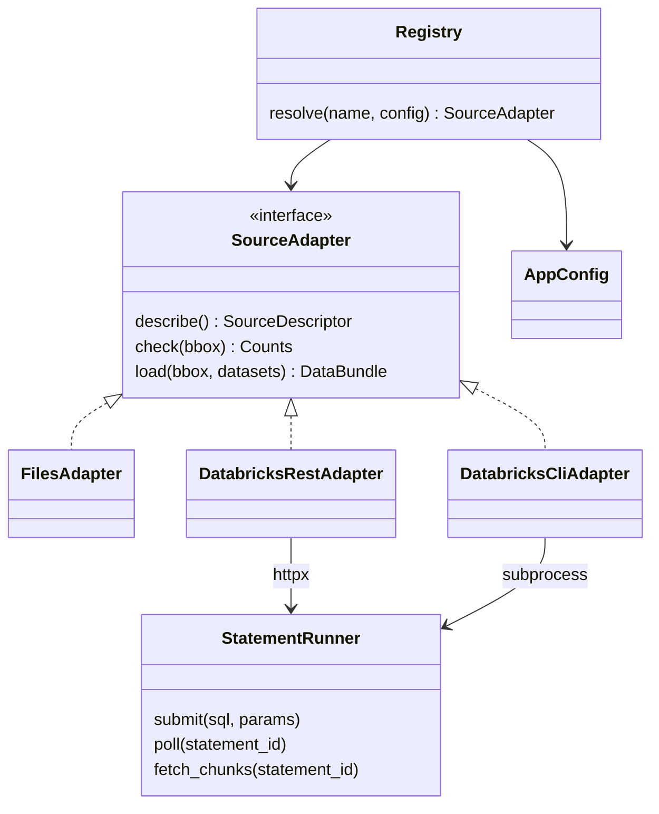
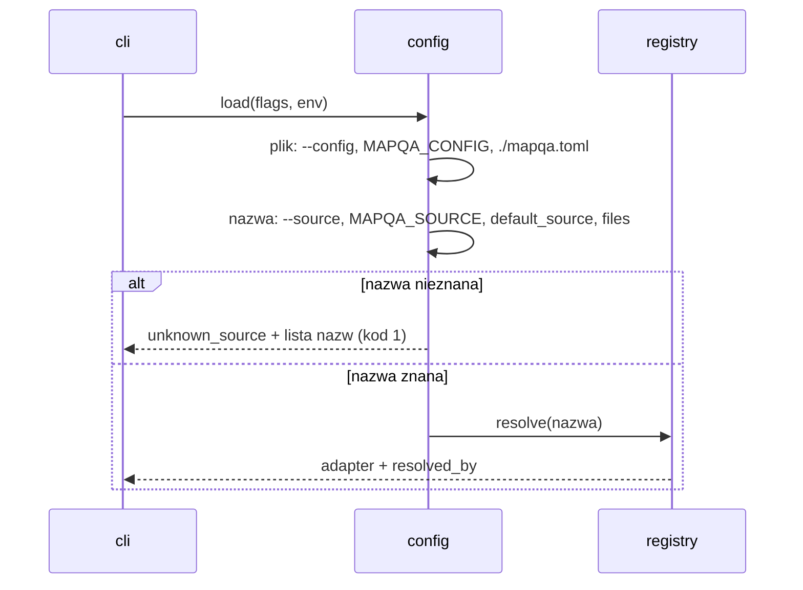
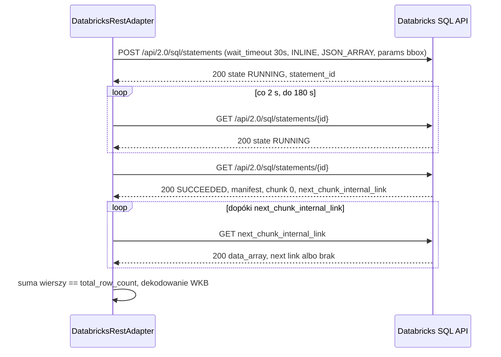
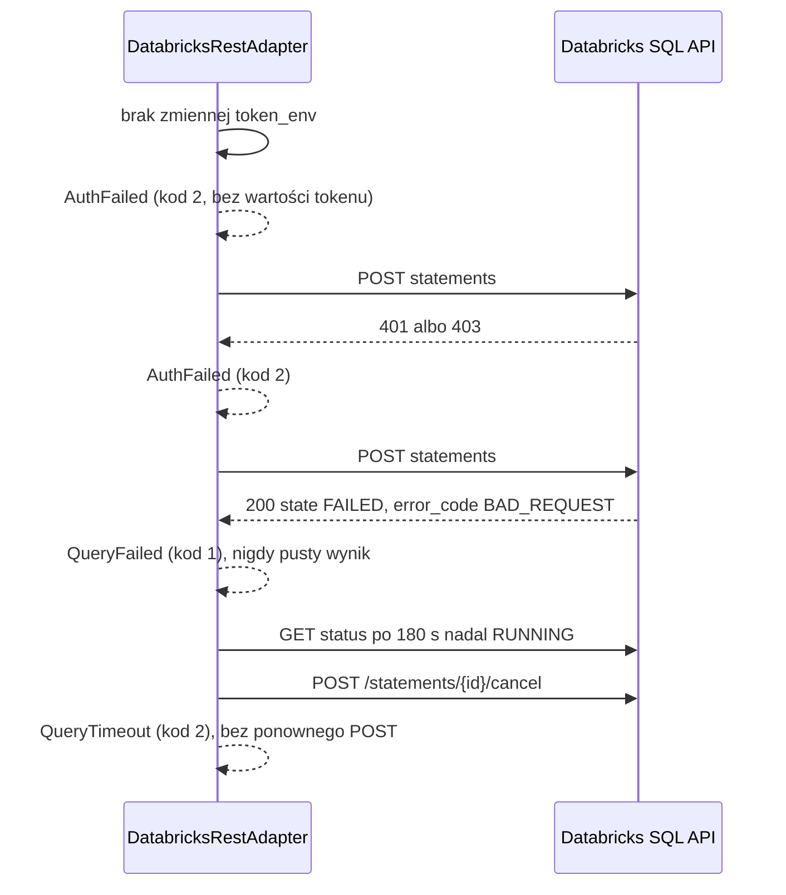

# ADR-001: Źródła danych i kontrakt danych

**Data:** 2026-11-03
**Status:** Accepted
**Dotyczy:** [`000-main-architecture.md`](000-main-architecture.md)
**PRD:** F1.3, F2, F8

---

## 1. Zakres

Obejmuje: konfigurację i wybór źródła (F8.1–F8.2), port `SourceAdapter`, kontrakt `DataBundle` (F8.4), adapter `files` [MVP], adapter `databricks` z dostępem `rest` i `cli` [P1], filtr bbox (F8.5), zdjęcia i odrzucone rekordy (F2.3, F8.6), obsługę zapytań Databricks (F8.7), sekrety (F8.8), polecenia `sources list/check` (F8.9).

Nie obejmuje: łączenia zdjęć z drogami (ADR-002), modeli (ADR-003), raportu (ADR-004).

---

## 2. Odniesienia do dokumentacji

| Biblioteka / usługa | Context7 ID albo dokumentacja | Zastosowanie |
|---|---|---|
| Databricks SQL Statement Execution API 2.0 | `/websites/databricks_api`; samouczek https://docs.databricks.com/aws/en/dev-tools/sql-execution-tutorial | `POST /api/2.0/sql/statements`, `GET .../{statement_id}`, `GET .../result/chunks/{chunk_index}` |
| Databricks CLI (wersja sprawdzona w danych kursu: 1.23.0) | `/databricks/cli` | `databricks api post /api/2.0/sql/statements --json ...` |
| GeoPandas 1.2.0 | `/geopandas/geopandas` | `read_parquet` (GeoParquet), `GeoSeries.from_wkb`, `to_crs` |
| httpx 0.28.1 | https://www.python-httpx.org/ | Klient REST |
| Pydantic 2.14.2 | https://docs.pydantic.dev/latest/ | Modele konfiguracji |
| Dane kursu | `course-materials/exercise-data/map-qa/README.md`, `DATABRICKS.md`, `sources.json` | Nazwy plików, liczności, kodowanie geometrii |

Fakty zweryfikowane 2026-11-03 i użyte w decyzjach:
- `wait_timeout` przyjmuje `0s` albo 5–50 s, domyślnie 10 s; `on_wait_timeout` = `CONTINUE` (domyślnie) albo `CANCEL`.
- Stany: `PENDING`, `RUNNING`, `SUCCEEDED`, `FAILED`, `CANCELED`, `CLOSED`. Stany końcowe zwracają HTTP 200 z ustawionym `status.state`; `FAILED` ma `status.error.error_code` i `message`.
- `INLINE` + `JSON_ARRAY`: limit 25 MiB; przekroczenie = stan błędu. Wartości w `data_array` są **stringami** (także liczby), typ podaje `manifest.schema.columns[].type_name`.
- Kolejne części: `result.next_chunk_index` i `result.next_chunk_internal_link` (ścieżka zaczyna się od `/`).
- Parametry nazwane `:name` z listą `parameters` (`name`, `value`, `type`; domyślnie `STRING`).
- Tabele `workspace.map_qa.*` przechowują geometrię jako **BINARY WKB** bez SRID (`sources.json` → `databricks.geometry_encoding`, `DATABRICKS.md`).

---

## 3. Projekt komponentów

### 3.1 Konfiguracja i wybór źródła

`config.load(cli_flags, env)` zwraca `AppConfig` (Pydantic, `extra="forbid"`):

1. **Plik konfiguracyjny:** pierwszy istniejący z: `--config`, `MAPQA_CONFIG`, `./mapqa.toml`. Wskazany flagą/zmienną, ale nieistniejący plik = błąd `config_not_found`, kod 1. **Wbudowane źródło** o nazwie `files` (typ `files`, `path = course-materials/exercise-data/map-qa`) istnieje zawsze, także gdy pliku nie ma; wpis `[sources.files]` w pliku je nadpisuje (ADR-000 D10-I7).
2. **Nazwa źródła:** `--source` > `MAPQA_SOURCE` > `default_source` z pliku > `files` (F8.1). Pole `resolved_by` zapisuje, który poziom wygrał.
3. **Nieznana nazwa:** kod 1, `error.code = unknown_source`, `error.hint` = posortowana lista nazw.
4. **Walidacja per typ:** `files` wymaga `path`; `databricks` wymaga `access ∈ {rest, cli}`, `schema` w formacie `katalog.schemat`, `host_env`, `warehouse_id_env`, `photos_dir`; dla `rest` także `token_env`. Pola `*_env` zawierają **nazwy** zmiennych, walidowane regexem `^[A-Z_][A-Z0-9_]*$` (odrzuca przypadkowe wklejenie tokenu).
5. **Opcje zapytań Databricks:** `query_timeout_s` (domyślnie 180), `poll_interval_s` (domyślnie 2), `wait_timeout_s` (domyślnie 30, dozwolone 5–50).

Brak przełączania źródła po cichu (F1.3): błąd źródła kończy run kodem 2 z podpowiedzią (`hint`) innego skonfigurowanego źródła, np. „Użyj `--source local`”.

### 3.2 Port `SourceAdapter`

Każdy adapter implementuje:
- `describe()` → `SourceDescriptor` (bez sekretów).
- `check(bbox)` → liczności całkowite i w bbox per zbiór; wyjątki jak `load`.
- `load(bbox, datasets)` → `DataBundle`; filtr bbox wykonuje adapter.

Wyjątki domenowe (mapowane w `cli` na kody wyjścia): `SourceUnavailable` (2), `AuthFailed` (2), `QueryFailed` (2 dla `PERMISSION_DENIED`/`UNAUTHENTICATED`, 1 dla pozostałych kodów błędu SQL), `QueryTimeout` (2), `ContractViolation` (1).

Rejestr `sources.registry` mapuje `type` → klasa adaptera. Nowy typ (PostGIS, S3/GeoParquet) = nowa klasa + wpis w rejestrze; kroki F3–F7 bez zmian (F8.4).

### 3.3 Adapter `files` [MVP]

- Czyta z katalogu `path` pliki o nazwach z danych kursu: `osm_roads.parquet`, `overture_segments.parquet` (GeoPandas `read_parquet`), `photos.csv`, `photo_road_links.csv`, `reference_labels.csv`, `traffic_signs.geojson`, oraz zestaw `signs/`: `signs.csv`, `labels.csv`, `nearest_osm.csv`, obrazy `crops/`, `photos/`.
- Pliki otwierane wyłącznie do odczytu; adapter nie tworzy plików w `path` (F2.2).
- Filtr bbox po wczytaniu: drogi — zachowane całe geometrie przecinające bbox (`intersects` z prostokątem w EPSG:4326, osie lon/lat); zdjęcia i znaki — punkt w bbox (granice włącznie). Zestaw `signs` jest filtrowany tylko przy jawnym `--bbox` (ADR-000 D10-I2); 24 ze 119 wycinków leży poza bbox Krakowa (pole `area`). Rekordy poza bbox trafiają do profilu jako `outside_bbox` (liczba, bez listy przy > 100).
- CRS: OSM ma EPSG:4326, Overture OGC:CRS84. Oba mają kolejność lon/lat; adapter ustawia CRS wyniku na EPSG:4326 bez transformacji współrzędnych (CRS84 i 4326 różnią się tylko deklarowaną kolejnością osi).
- Zdjęcia: plik obrazu = `photos_dir/filename` (dla `photos.csv`: katalog `offline/` albo `data/photos/` z `download_photos.py`; dla `signs`: `signs/crops/` i `signs/photos/`). Weryfikacja `sha256` pliku z manifestem (`sha256` dla pliku pochodnego, `crop_sha256` dla wycinka). Brak pliku → `missing_file`; inny hash → `hash_mismatch`. Rekord pozostaje w `photos` z polem `image_status`, ale nie trafia do kaskady.

### 3.4 Adapter `databricks`, dostęp `rest` [P1]

Przebieg jednego zapytania:
1. `POST /api/2.0/sql/statements` z `warehouse_id`, `statement`, `parameters` (bbox jako `DOUBLE`), `wait_timeout = "{wait_timeout_s}s"`, `on_wait_timeout = CONTINUE`, `disposition = INLINE`, `format = JSON_ARRAY`.
2. Gdy stan `PENDING`/`RUNNING`: `GET /api/2.0/sql/statements/{id}` co `poll_interval_s`, aż do stanu końcowego albo upływu `query_timeout_s` od wysłania. Po przekroczeniu: `POST .../{id}/cancel`, wyjątek `QueryTimeout` (bez ponownego wysłania zapytania, F8.7).
3. `SUCCEEDED`: odczyt `result.data_array`; dopóki jest `next_chunk_internal_link`, `GET` tej ścieżki (doklejonej do hosta bez podwójnego `/`). Suma wierszy musi równać się `manifest.total_row_count`; inaczej `ContractViolation`.
4. `FAILED`: wyjątek `QueryFailed` z `error_code` i `message` (bez treści zapytania z parametrami); **nigdy** pusty wynik. `CANCELED`/`CLOSED` bez danych: `QueryFailed`.
5. HTTP 401/403 → `AuthFailed`; HTTP 429/5xx/timeout połączenia **przy wysyłaniu** → `SourceUnavailable` bez ponowienia (zapytanie mogło wystartować). Odpytywanie `GET` statusu może być powtórzone przy błędzie sieci do 3 razy, bo nie uruchamia zapytania ponownie.
6. Konwersja: kolumny według `type_name` (`LONG`/`INT` → Int64, `DOUBLE`/`FLOAT` → float, `BOOLEAN`, `TIMESTAMP` → datetime UTC, `STRING`); geometria pobierana w SQL jako `hex(geometry)` i dekodowana w Pythonie z WKB; struktury/listy Overture pobierane jako `to_json(kolumna)` i parsowane do tej samej postaci co w GeoParquet.

**Filtr bbox w SQL (F8.5):** drogi przez `ST_Intersects(ST_GeomFromWKB(geometry, 4326), ST_GeomFromText(<prostokąt z :minx :miny :maxx :maxy>, 4326))` — zwraca całe ways przecinające bbox; zdjęcia przez `longitude BETWEEN :minx AND :maxx AND latitude BETWEEN :miny AND :maxy`. Wartości bbox wyłącznie jako parametry nazwane, nigdy przez sklejanie stringów. Dokładna składnia funkcji `ST_*` w Databricks SQL jest weryfikowana nagraniem (§8, scenariusz DB-01) przed implementacją.

**Zestaw `signs/`** nie istnieje w Databricks (PRD §9). Dla źródła `databricks` dostępny jest tylko `--dataset photos`; `--dataset signs` → kod 1, `error.code = dataset_not_available`, `hint` = źródło `files`.

### 3.5 Adapter `databricks`, dostęp `cli` [P1]

To samo zapytanie co §3.4 wysłane przez `subprocess` z listą argumentów (bez `shell=True`): `databricks api post /api/2.0/sql/statements --json <plik tymczasowy>`; odpytywanie i chunki przez `databricks api get <ścieżka>`. Uwierzytelnianie zapewnia profil CLI albo zmienne środowiskowe CLI; adapter nie przekazuje tokenu w argumentach. Kod wyjścia CLI ≠ 0 → `SourceUnavailable` z pierwszą linią stderr po redakcji sekretów. Brak programu `databricks` w PATH → `SourceUnavailable` z podpowiedzią `access = "rest"`.

### 3.6 Sekrety

- Wartość tokenu odczytywana z `os.environ[token_env]` dopiero w konstruktorze klienta HTTP, przechowywana tylko w nagłówku `Authorization` klienta.
- Globalny filtr redakcji (`logging.Filter` + funkcja `redact()` używana w komunikatach błędów i przy zapisie nagrań) zastępuje wartości wszystkich zmiennych z `*_env` i `OPENROUTER_API_KEY` ciągiem `***`.
- `SourceDescriptor` zawiera host bez ścieżek i parametrów, nazwy zmiennych, schemat, tabele — bez wartości sekretów.

---

## 4. Struktury danych — kontrakt `DataBundle`

Wszystkie geometrie EPSG:4326 (lon/lat). Każde źródło zwraca te same kolumny i typy logiczne; dodatkowe kolumny są dozwolone tylko z prefiksem `src_`. `ContractViolation` przy braku kolumny wymaganej lub złym typie.

| Zbiór | Klucz | Wymagane kolumny (typ logiczny) | Uwagi |
|---|---|---|---|
| `osm_roads` | `osm_id` (Int64) | `highway` (str), `maxspeed`, `surface`, `lit` (str \| null), `tags` (mapa str→str), `node_ids` (lista Int64), `geometry` (LineString) | `tags` zawiera surowe `maxspeed:*`; liczności: 99 768 |
| `overture_segments` | `id` (str, GERS) | `class` (str), `speed_limits` (lista struktur: `max_speed` {`value`, `unit`}, `min_speed`, `when`, `between`, `is_max_speed_variable`), `road_surface` (lista {`value`, `between`}), `sources` (lista {`dataset`, `record_id`, `between`, ...}), `geometry` (LineString), `version`/wydanie (str) | Dokładne pola zagnieżdżone potwierdza test kontraktu na GeoParquet; liczności: 85 405 |
| `photos` | `photo_id` (str) | `filename`, `source`, `source_url`, `longitude`, `latitude` (float), `heading` (float \| **null**), `captured_at` (datetime UTC), `sequence` (str), `license`, `author`, `sha256`, `is_panorama` (bool), `image_path` (ścieżka \| null), `image_status` (`ok`, `missing_file`, `hash_mismatch`) | `heading = 0.0` ≠ null (F2.4); liczności: 561 |
| `photo_road_links` | `photo_id` | `osm_way_id` (Int64 \| null), `overture_id` (str \| null), `distance_m`, `way_bearing`, `bearing_diff`, `directed_bearing_diff` (float \| null), `osm_candidate_count` (Int64), `match_method` (str), `candidate_flags` (zbiór str) | Punkt odniesienia dla F3.5; 561 |
| `traffic_signs` | `id` | `object_value` (str), `first_seen_at`, `last_seen_at`, `image_ids` (lista str), `geometry` (Point) | 1730 |
| `signs` [MVP, tylko `files`] | `photo_id` | jak `photos` + `crop_sha256`, `crop_path`, `mapillary_value` (str), `area` (str) | 119 |
| `sign_labels` [MVP] | `photo_id` | `sign_value` (str: liczba, `none`, `unreadable`), `status` (`certain`/`uncertain`), `negative_type` | 119 (115 `certain`) |
| `sign_nearest_osm` [MVP] | `photo_id` | `osm_way_id`, `distance_m`, `heading_diff_deg`, `highway`, `maxspeed`, `maxspeed_forward`, `maxspeed_backward`, `maxspeed_conditional`, `oneway`, `candidate_count`, `match_flags` (zbiór str), `osm_timestamp` | Zastępuje F3 w MVP |
| `reference_labels` | (`photo_id`, `question`) | `label`, `status`, `method`, `reviewer`, `reviewed_at` | Ewaluacja §7 |

Puste pola CSV są wczytywane jako null (nie jako `""` ani 0). Kolumna `heading` jest float z null; test kontraktu sprawdza, że żadna wartość null nie zamienia się w 0.

`SourceDescriptor`: `name`, `type`, `access` (`local` \| `rest` \| `cli`), `locations` (ścieżki plików albo `schema.tabela`), `read_started_at`, `read_finished_at`, `row_counts` (per zbiór: total, in_bbox).

---

## 5. Kontrakty interfejsów

| Interfejs | Wejście | Wyjście | Błędy |
|---|---|---|---|
| `SourceAdapter.load` | `bbox`, lista zbiorów | `DataBundle` + `SourceDescriptor` + lista `RejectedRecord` | `SourceUnavailable`, `AuthFailed`, `QueryFailed`, `QueryTimeout`, `ContractViolation` |
| `SourceAdapter.check` | `bbox` | `{dataset: {total, in_bbox}}`, `reachable`, `warnings` | jak wyżej |
| `mapqa sources list` | `--config`, `--output` | lista źródeł z `resolved_by` | `config_invalid` (1) |
| `mapqa sources check` | `--source`, `--bbox`, `--output` | liczności; ostrzeżenie, gdy liczności różnią się od referencji plików (F2.5) | kody 1/2 |

Referencyjne liczności (README danych, PRD kryterium 17): `osm_roads` 99 768, `overture_segments` 85 405, `photos` 561, `photo_road_links` 561, `traffic_signs` 1730. `sources check` porównuje z nimi, gdy bbox = bbox danych; rozbieżność = ostrzeżenie, nie błąd.

---

## 6. Decyzje techniczne

### D-001-1. Pliki jako źródło domyślne i referencyjne
**Status:** Accepted
**Data:** 2026-11-03
**Kontekst:** Zestaw `signs/` istnieje tylko lokalnie; Databricks wymaga tokenu z czatu i sieci. MVP ma działać offline.
**Decyzja:** Wbudowane źródło `files` jest domyślne; wyniki `files` są wzorcem w testach zgodności `files` ↔ `databricks` (F8.10).
**Odrzucone alternatywy:**
- Databricks jako domyślne: blokuje pracę bez tokenu i testy w CI.
**Konsekwencje:**
- (+) MVP i testy działają bez chmury.
- (-) Filtr bbox po stronie klienta dla plików (pełny odczyt ~24 MB).
**Warunek rewizji:** Gdy pliki lokalne przestaną być aktualnym snapshotem (nowe wydanie Overture/OSM tylko w Databricks).

### D-001-2. INLINE + JSON_ARRAY zamiast EXTERNAL_LINKS + ARROW_STREAM
**Status:** Accepted
**Data:** 2026-11-03
**Kontekst:** Największa tabela (`osm_roads`, ~10 MB jako Parquet) w JSON z WKB w hex może zbliżyć się do limitu 25 MiB na wynik INLINE. EXTERNAL_LINKS wymaga pobierania z prezentowanych URL bez nagłówka autoryzacji.
**Decyzja:** INLINE + JSON_ARRAY, czytanie wszystkich chunków. Kolumny pobierane jawnie (bez `SELECT *`), `tags` jako JSON. Jeśli test DB-02 na pełnym bbox zwróci błąd limitu, adapter dzieli zapytanie dróg na pasy bbox po długości geograficznej (4 pasy), deduplikując `osm_id`.
**Odrzucone alternatywy:**
- EXTERNAL_LINKS + ARROW_STREAM: szybsze dla dużych wyników, ale druga ścieżka pobierania i zależność od pyarrow IPC; niepotrzebne przy 100 tys. wierszy.
**Konsekwencje:**
- (+) Jeden format odpowiedzi; prosty mock z nagrania.
- (-) Większy transfer niż Arrow; możliwy podział na pasy.
**Warunek rewizji:** Gdy wynik pojedynczego zbioru przekroczy 25 MiB mimo podziału albo czas odczytu > 60 s.

### D-001-3. Geometria przez `hex(WKB)`, struktury przez `to_json`
**Status:** Accepted
**Data:** 2026-11-03
**Kontekst:** Tabele mają geometrię BINARY WKB; reprezentacja BINARY w JSON_ARRAY nie jest opisana w przeczytanej dokumentacji.
**Decyzja:** Zapytanie zwraca `hex(geometry)` (string), Python dekoduje WKB i ustawia EPSG:4326. Listy/struktury Overture i mapy tagów jako `to_json(...)`.
**Odrzucone alternatywy:**
- `ST_AsText` (WKT): większy rozmiar i utrata precyzji przy formatowaniu liczb.
- Surowa kolumna BINARY: niepewne kodowanie (base64?) bez nagrania.
**Konsekwencje:**
- (+) Deterministyczna, bezstratna geometria; ta sama postać co z GeoParquet.
- (-) Hex podwaja rozmiar WKB w transferze.
**Warunek rewizji:** Gdy tabele zmienią typ kolumny na natywny GEOMETRY.

### D-001-4. Brak automatycznego ponawiania wysłanego zapytania
**Status:** Accepted
**Data:** 2026-11-03
**Kontekst:** F8.7 zabrania ponawiania zapytania, które może nadal działać.
**Decyzja:** `POST /statements` wysyłany najwyżej raz na zapytanie; ponawiany może być tylko `GET` statusu/chunku (≤ 3 razy przy błędzie sieci). Po `query_timeout_s` adapter wysyła `cancel` i zgłasza błąd.
**Odrzucone alternatywy:**
- Retry z backoff na `POST`: ryzyko zdublowanych zapytań i kosztu warehouse.
**Konsekwencje:**
- (+) Zgodność z F8.7, przewidywalny koszt.
- (-) Przejściowy błąd sieci przy wysyłaniu kończy run kodem 2.
**Warunek rewizji:** Gdy API zacznie obsługiwać klucz idempotencji żądania.

### D-001-5. Konfiguracja przechowuje tylko nazwy zmiennych sekretów
**Status:** Accepted
**Data:** 2026-11-03
**Kontekst:** F8.8 i kryterium 13 PRD.
**Decyzja:** Pola `*_env` z walidacją wzorca nazwy; wartość odczytywana w kliencie; globalna redakcja w logach, błędach i nagraniach.
**Odrzucone alternatywy:**
- Plik `.env` ładowany przez narzędzie: zwiększa ryzyko zatwierdzenia sekretu i rozmywa precedencję.
**Konsekwencje:**
- (+) Plik `mapqa.toml` można bezpiecznie zatwierdzić.
- (-) Użytkownik ustawia zmienne w PowerShell (`$env:DATABRICKS_TOKEN=...`).
**Warunek rewizji:** Przy wprowadzeniu OAuth (profil CLI jako jedyne źródło uwierzytelnienia).

---

## 7. Diagramy

### Diagram komponentów

### Sekwencja: wybór źródła

### Sekwencja: zapytanie Databricks REST (sukces, odpytywanie, chunki)

### Sekwencja: błędy Databricks

---

## 8. Strategia testów

Nagrania Databricks (`tests/fixtures/captures/databricks/`) powstają z prawdziwych zapytań do `workspace.map_qa` na tokenie kursowym: status HTTP, nagłówki bez `Authorization`, pełne ciało, metadane (data, host bez sekretów, `warehouse_id` zastąpione `<WAREHOUSE>`, treść SQL, wersja CLI). Bez nagrania testów integracyjnych Databricks się nie pisze (AGENTS.md); brak tokenu = zgłoszenie brakującego warunku.

| Scenariusz | Typ | Wejście | Oczekiwany wynik | Przypadki brzegowe |
|---|---|---|---|---|
| CFG-01 precedencja | Unit | kombinacje flagi/env/pliku | wygrywa poziom z F8.1, poprawne `resolved_by` | pusta wartość `MAPQA_SOURCE=""` = nieustawiona |
| CFG-02 nieznane źródło | Unit | `--source nope` | kod 1, lista nazw posortowana | literówka w `default_source` |
| CFG-03 nazwy zmiennych | Unit | `token_env = "dapi123..."` | `config_invalid` (wzorzec nazwy) | małe litery |
| CFG-04 brak pliku konfiguracyjnego | Unit | brak `mapqa.toml` | źródło wbudowane `files` | `--config` wskazuje nieistniejący plik → kod 1 |
| FIL-01 liczności | Contract | pełne pliki kursu, bbox danych | 99 768 / 85 405 / 561 / 561 / 1730 | bbox częściowy → in_bbox < total |
| FIL-02 heading NULL | Contract | `photos.csv` | puste `heading` = null; `0.0` zachowane jako 0.0 | wszystkie 15 zdjęć z `missing_heading` w linkach mają null |
| FIL-03 brak pliku zdjęcia | Unit | manifest z nieistniejącym `filename` | `RejectedRecord(missing_file)`, run trwa | ścieżka z polskimi znakami |
| FIL-04 zły hash | Unit | plik zmieniony o 1 bajt | `hash_mismatch` | wielkość liter hex |
| FIL-05 drogi przecinające bbox | Unit | syntetyczna linia częściowo w bbox | zachowana cała geometria | linia styczna do krawędzi bbox |
| FIL-06 read-only | Unit | uruchomienie na kopii danych | brak nowych/zmienionych plików w `path` (porównanie mtime + hash) | — |
| CON-01 kontrakt | Contract | `files` i `databricks` (z nagrań) | te same kolumny, typy, CRS EPSG:4326, null ≠ 0 | dodatkowe kolumny tylko z `src_` |
| DB-01 składnia SQL | Capture | jedno zapytanie z `ST_Intersects` na małym bbox | stan SUCCEEDED, nagranie zapisane | — |
| DB-02 pełny bbox | Capture + E2E | `osm_roads` pełny bbox | wszystkie chunki, 99 768 wierszy | błąd limitu 25 MiB → podział na pasy |
| DB-03 odpytywanie | Integration | nagranie RUNNING → SUCCEEDED | poprawna liczba GET, wynik pełny | `PENDING` przed `RUNNING` |
| DB-04 chunki | Integration | nagranie z `next_chunk_internal_link` | wszystkie części, suma = `total_row_count` | link z wiodącym `/` |
| DB-05 FAILED | Integration | nagranie FAILED | `QueryFailed`, kod 1, brak pustego wyniku | `CANCELED` |
| DB-06 401/403 | Integration | odpowiedź 401 i 403 | kod 2, komunikat bez tokenu | brak zmiennej tokenu |
| DB-07 timeout | Integration | RUNNING dłużej niż limit (sztuczny zegar) | `cancel` wysłany, `QueryTimeout`, 1 POST statements | — |
| DB-08 zgodność | E2E | `sources check --source course-databricks` | liczności = FIL-01 | rozbieżność → ostrzeżenie |
| CLI-01 cli access | Integration | fałszywy program `databricks` w PATH testu | te same wyniki co REST | brak programu → kod 2 z hint |

### Techniczne kryteria akceptacji

- TAC-001-01: Testy kontraktowe (`tests/contract/`) są jednym zestawem parametryzowanym po adapterze i przechodzą dla `files` oraz `databricks` (nagranie).
- TAC-001-02: `mapqa sources list --output json` zwraca dla konfiguracji z PRD F8.2 dwa źródła z polami `name`, `type`, `access`, `is_default`.
- TAC-001-03: W żadnym teście z fałszywym tokenem wzorzec tokenu nie występuje w wyjątkach, logach, `run.json`, raportach ani nagraniach.
- TAC-001-04: Adapter `databricks` wykonuje dokładnie 1 `POST /api/2.0/sql/statements` na zbiór w każdym scenariuszu błędu (licznik tras respx).
- TAC-001-05: Bbox trafia do SQL wyłącznie przez `parameters`; test sprawdza, że tekst `statement` nie zawiera wartości liczbowych bbox.
- TAC-001-06: `--no-model` na `files` i `databricks` z tymi samymi danymi daje identyczną listę id kandydatów i liczności (pomijając `SourceDescriptor`) [P1].
