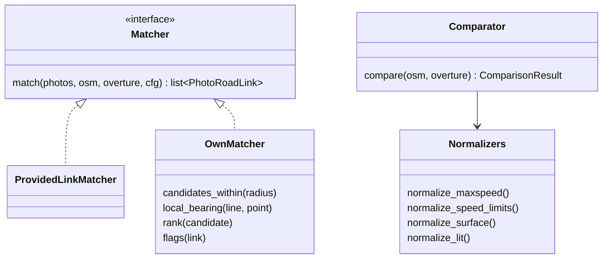
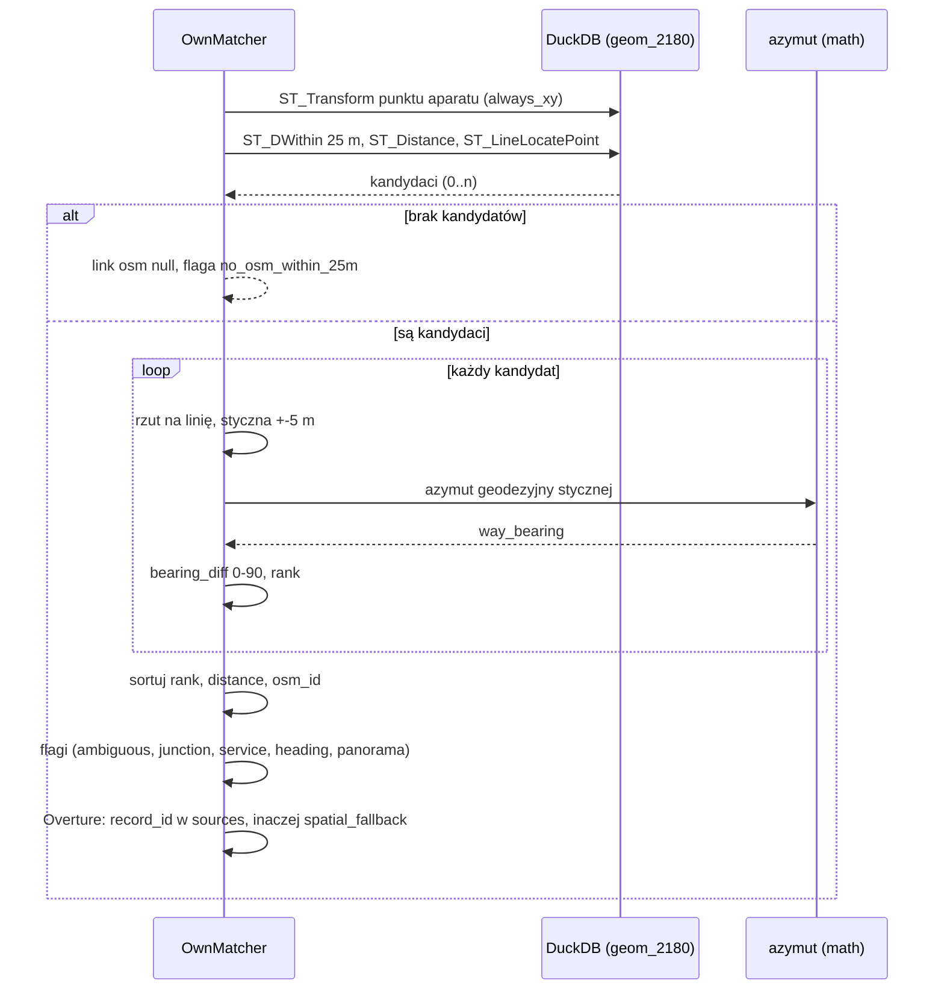
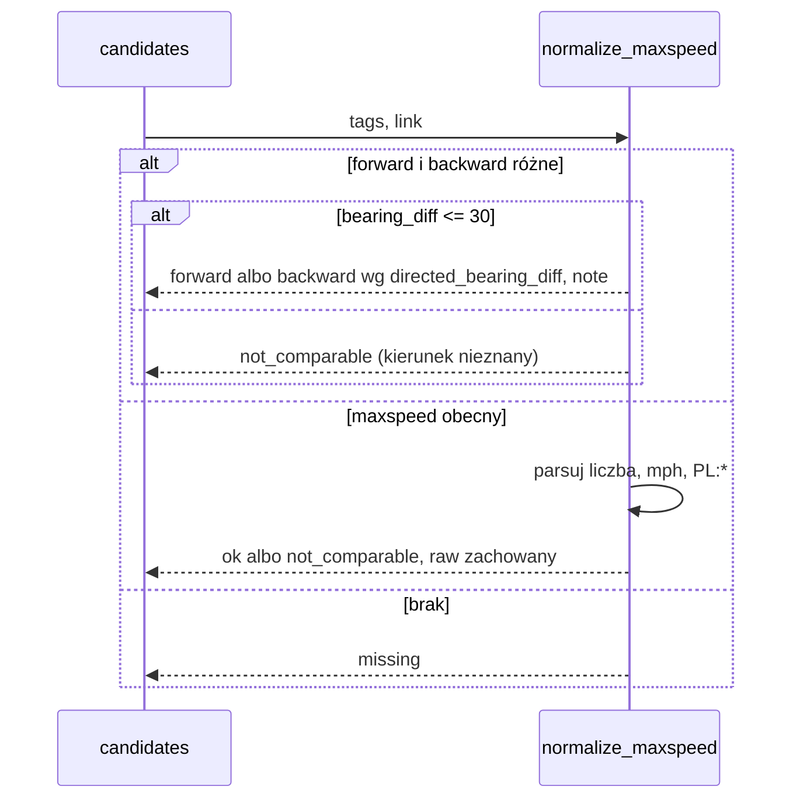

# ADR-002: Łączenie zdjęć z drogami, normalizacja i porównanie atrybutów

**Data:** 2026-11-03
**Status:** Accepted
**Dotyczy:** [`000-main-architecture.md`](000-main-architecture.md)
**PRD:** F2.4, F3, F4

---

## 1. Zakres

Obejmuje: transformację CRS do metrów (EPSG:2180), własne łączenie zdjęcie → droga OSM i Overture z flagami [P1], adapter gotowych dopasowań `signs/nearest_osm.csv` [MVP], normalizację `maxspeed`/`maxspeed:*` [MVP], `speed_limits` Overture [P3], `surface`/`road_surface` [P5], `lit` [P2] oraz porównanie OSM ↔ Overture (F4.3) [P3].

Nie obejmuje: odczytu ze zdjęć (ADR-003), reguł kandydatów i priorytetów (ADR-004).

---

## 2. Odniesienia do dokumentacji

| Biblioteka | Context7 ID albo dokumentacja | Zastosowanie |
|---|---|---|
| DuckDB 1.5.6 + `spatial` (silnik, ADR-000 D2) | `/websites/duckdb_current`; https://duckdb.org/docs/stable/core_extensions/spatial/functions | `ST_Transform(geom, 'EPSG:4326', 'EPSG:2180', always_xy := true)` — wymaga `always_xy`, bo EPSG:4326 ma oś lat/lon; `ST_DWithin`, `ST_Distance`, `ST_LineLocatePoint` (ułamek długości 2D), `ST_LineInterpolatePoint`, `ST_LineSubstring` |
| pyproj 3.8.0 (dev, wyrocznia) | https://pyproj4.github.io/pyproj/stable/ | `Transformer` z `always_xy=True`, `Geod` (azymut geodezyjny) — tylko w testach |
| GeoPandas 1.2.0 (dev, wyrocznia) | `/geopandas/geopandas` | `to_crs("EPSG:2180")`, dystans — tylko w testach |
| Reguła połączeń kursu | `course-materials/exercise-data/map-qa/sources.json` → `links` | Promień, styczna, ranking, remisy, Overture |
| OSM `maxspeed` | https://wiki.openstreetmap.org/wiki/Key:maxspeed | Składnia wartości, jednostki, wartości domyślne `PL:*` |
| Overture transportation schema | https://docs.overturemaps.org/schema/reference/transportation/segment/ | `speed_limits`, `road_surface`, `between`, `when`, `sources` |

---

## 3. Projekt komponentów

### 3.1 CRS

- Wszystkie obliczenia metryczne w **EPSG:2180** (PUWG 1992). Transformacja wyłącznie w DuckDB: `ST_Transform(geom, 'EPSG:4326', 'EPSG:2180', always_xy := true)` dla warstw i punktów aparatu (punkt budowany jako (lon, lat)). Bez `always_xy` DuckDB traktuje EPSG:4326 jako (lat, lon) i daje błędny wynik bez komunikatu. Kolumny metryczne mają przyrostek `_2180`; test statyczny zabrania `ST_Distance`/`ST_DWithin` na innych kolumnach (przyjęte za wersją referencyjną prowadzącego, ADR-002 §3.1). Dane wejściowe mają kolejność lon/lat (OSM EPSG:4326 w GeoParquet, Overture OGC:CRS84; `sources.json` → `coordinate_order = "longitude, latitude"`).
- Funkcje rdzenia w Pythonie przyjmują wyniki zapytań z jawną informacją o CRS (nazwa kolumny `_2180` albo `_4326`); funkcja licząca dystans/ranking odrzuca kolumny bez `_2180` (`ValueError`), co zapobiega liczeniu w stopniach (kryterium 3).
- Kierunki (`way_bearing`, `heading`) to azymuty względem **północy geograficznej**: lokalną styczną wyznaczamy w EPSG:2180, a jej końce przeliczamy z powrotem do EPSG:4326 (`ST_Transform(..., 'EPSG:2180', 'EPSG:4326', always_xy := true)`) i liczymy azymut początkowy funkcją w Pythonie (stdlib `math`, wzór na sferze; dla odcinka 10 m różnica względem elipsoidy WGS84 jest pomijalna). Test porównuje wynik z `pyproj.Geod` (WGS84) z tolerancją 0,1°. Unikamy błędu zbieżności południków PUWG 1992 (do ~±4° na krańcach Polski).

### 3.2 Łączenie zdjęcie → droga OSM [P1]

Reguła zgodna z `sources.json` → `links`, aby wynik był porównywalny z `photo_road_links.csv` (F3.5):

1. **Kandydaci:** drogi OSM w promieniu **25 m** od pozycji aparatu (SQL DuckDB: `ST_DWithin(road.geom_2180, photo.geom_2180, 25)` z `ST_Distance` jako `distance_m`). Brak kandydata → `no_osm_within_25m`, `osm_way_id = null`; to stan danych, nie kandydat rozbieżności (F3.4).
2. **Lokalna styczna:** punkt aparatu rzutowany na linię (`ST_LineLocatePoint` na `geom_2180`, ułamek długości); styczna = `ST_LineSubstring` między ułamkami odpowiadającymi −5 m i +5 m od rzutu (przycięte do [0, 1]); azymut geodezyjny jak w §3.1. Kroki 1–2 to jedno zapytanie SQL; kroki 3–6 liczy Python na jego wyniku.
3. **Różnica kierunku:** `directed_bearing_diff` = |heading − way_bearing| sprowadzona do 0–180°; `bearing_diff` = min(d, 180 − d) w zakresie **0–90°** (oba kierunki geometrii, F3.2).
4. **Ranking:** `rank = distance_m + bearing_diff / 9`; brak heading → `rank = distance_m + 5`. Najniższy `rank` wygrywa.
5. **Remisy:** przy równym `rank` (różnica < 1e-9) wygrywa mniejszy `distance_m`, potem mniejszy `osm_id` — wynik deterministyczny.
6. **Overture:** najpierw segment, którego `sources[].record_id` wskazuje wybrany way OSM (format `w<osm_id>@<wersja>`) i który leży ≤ 25 m od aparatu (`match_method = osm_source_reference`); w przeciwnym razie najbliższy segment ≤ 25 m (`spatial_fallback`, flaga `overture_spatial_only`); brak → `overture_id = null`.

### 3.3 Flagi połączenia

Zbiór flag jest zapisywany przy każdym połączeniu; żadna flaga nie usuwa zdjęcia z wyniku (F3.3, kryterium 5).

| Flaga | Warunek | Źródło progu |
|---|---|---|
| `ambiguous_candidates` | drugi najlepszy kandydat ma `rank` ≤ najlepszy + 2 m | `sources.json` |
| `junction_nearby` | węzeł OSM współdzielony przez ≥ 3 drogi (stopień z `node_ids` w wycinku) leży ≤ 15 m od rzutu aparatu | ADR (konfigurowalne `junction_radius_m`) |
| `service_way` | `highway ∈ {service, track}` wybranej drogi | ADR |
| `missing_heading` | `heading` jest null (nigdy dla `0.0`, F2.4) | PRD |
| `panorama_heading_ambiguous` | `is_panorama = true` | dane kursu |
| `poor_heading_alignment` | `bearing_diff > 30°` | ADR (konfigurowalne `heading_tolerance_deg`) |
| `camera_against_way_direction` | `directed_bearing_diff > 90°` przy `oneway=yes` | dane kursu; flaga przeglądu, nie naruszenie dostępu |
| `boundary_crossing` | geometria drogi wychodzi poza bbox runu | dane kursu |
| `no_osm_within_25m` | brak kandydatów | PRD |
| `overture_spatial_only` | Overture dopasowane bez referencji do OSM | dane kursu |
| `outside_standard_25m` | (tylko `signs/nearest_osm.csv`) dopasowanie dalej niż 25 m | dane kursu |
| `grade_separated` [P1] | wybrana droga OSM ma `bridge` (≠ `no`), `tunnel` (≠ `no`) albo `layer` ≠ 0, albo segment Overture ma niepuste `level_rules`; kadr może pokazywać inny poziom drogi | wersja referencyjna prowadzącego (ADR-002 §3.4) |
| `service_or_restricted` [P1] | `highway = service` albo `access` / `motor_vehicle` ∈ {`private`, `no`, `destination`} | wersja referencyjna prowadzącego (ADR-002 §3.4) |
| `distance_mismatch` [P1] | (tylko `link_source = provided`) dystans aparat → wybrana droga OSM przeliczony w EPSG:2180 (`distance_m_recomputed`) różni się od dostarczonego `distance_m` o > 0,5 m | wersja referencyjna prowadzącego (ADR-002 §3.2) |

Flagi `grade_separated`, `service_or_restricted` i `distance_mismatch` (przyjęte za wersją referencyjną prowadzącego) wymagają tagów i geometrii z `osm_roads`/`overture_segments`, więc są liczone od [P1]; w MVP (`signs/nearest_osm.csv` bez pełnych tagów i bez czytania GeoParquet) nie występują, a raport to zaznacza. `service_way` (wymagane przez PRD F3.3) pozostaje obok `service_or_restricted`. W przeciwieństwie do wersji referencyjnej flagi nie zmieniają połączenia w „niejednoznaczne”: obniżają tylko priorytet kandydata do `średni` (ADR-004 §3.2).

„Czyste połączenie” dla priorytetu `wysoki` (F6.3, ADR-004) = zbiór flag pusty albo zawiera wyłącznie `boundary_crossing`.

### 3.4 Gotowe dopasowanie w MVP

`ProvidedLinkMatcher` [MVP] mapuje `signs/nearest_osm.csv` (zestaw `signs`) i `photo_road_links.csv` (zestaw `photos`, przed P1) na `PhotoRoadLink` z `link_source = provided`; `match_flags`/`candidate_flags` rozdzielone separatorem potwierdzonym testem `SELECT DISTINCT` (ADR-001 §3.7) trafiają do zbioru flag bez zmian. Od [P1] dla połączeń `provided` liczony jest też `distance_m_recomputed` w EPSG:2180 i flaga `distance_mismatch` (§3.3). Od [P1] `OwnMatcher` liczy połączenia sam, a raport pokazuje odsetek zgodnych `osm_way_id` z `photo_road_links.csv` (z mianownikiem = zdjęcia z dopasowaniem w obu).

### 3.5 Normalizacja wartości

Każda funkcja normalizująca zwraca `AttributeValue` (`raw` bez zmian, `normalized`, `status`, `note`, dla prędkości także `speed_source`). Surowe wartości są zawsze pokazywane w raporcie (F4.2).

**OSM `maxspeed` [MVP]** (kolejność reguł):

| Wejście (`raw`) | `normalized` | `status` |
|---|---|---|
| liczba, np. `50` | 50 | `ok`, `speed_source = explicit` |
| `<n> mph` (także `<n>mph`, wielkość liter dowolna) | round(n × 1,609344; 2), np. `30 mph` → 48,28 | `ok`, `speed_source = explicit`, `note = "przeliczono z mph"` |
| `<n> km/h` | n | `ok`, `speed_source = explicit` |
| `PL:urban` | 50 | `ok`, `speed_source = implicit`, `note = "wartość domyślna PL:urban (obszar zabudowany)"` |
| `PL:rural` | 90 | `ok`, `speed_source = implicit`, `note = "wartość domyślna PL:rural (poza obszarem zabudowanym)"` |
| `PL:zone<n>` / `PL:zone:<n>` (np. `PL:zone30`) | n | `ok`, `speed_source = implicit`, `note = "strefa PL:zone<n>"` |
| `PL:motorway` | 140 | `ok`, `speed_source = implicit`, `note = "wartość domyślna PL:motorway"` |
| `PL:expressway` | 120 | `ok`, `speed_source = implicit`, `note = "wartość domyślna PL:expressway (dwujezdniowa)"` |
| `PL:living_street` | 20 | `ok`, `speed_source = implicit`, `note = "wartość domyślna PL:living_street (strefa zamieszkania)"` |
| inny kod `PL:*` spoza tej tabeli (np. `PL:trunk`) | null | `not_comparable`, `speed_source = implicit`, `note = "nieznany kod PL:*"` |
| wiele wartości (`50;70`), `none`, `signals`, `variable`, `walk`, inne | null | `not_comparable`, `note` z powodem |
| brak tagu | null | `missing` (nigdy 0 ani `none`) |

**Wartości domyślne `PL:*` (decyzja użytkownika 2026-11-12, D-002-4):** wartość liczbowa jest zachowana i porównywana (np. `PL:urban` → 50 km/h), ale wynik zawsze ma `speed_source = implicit`. Pełna tabela powyżej to jedyne wspierane kody; dotyczą samochodu osobowego bez warunków dodatkowych (pora doby, przyczepa). Raport pokazuje surowy tag, wartość i etykietę „implicit” w kolumnie OSM; powód kandydata i wynik porównania z wartością `implicit` po którejkolwiek stronie są oznaczone jako „porównanie z wartością domyślną” (ADR-004 §3.3). Wersja referencyjna prowadzącego nie podstawia wartości (`kind = implicit`, `value_kmh = NULL`); przyjmujemy tylko jego oznaczenie `implicit`.

**Równość prędkości (przyjęte za wersją referencyjną prowadzącego, ADR-001 §3.3):** dwie wartości km/h są równe, gdy |Δ| < 0,5 km/h; |Δ| ≥ 0,5 km/h → różne. Reguła obowiązuje w porównaniu OSM ↔ Overture (§3.6) i odczyt ↔ mapa (ADR-004 §3.1). Wartości z mph przeliczamy przed porównaniem i zaokrąglamy do 0,01 km/h.

**Tagi kierunkowe:** gdy `maxspeed:forward` i `maxspeed:backward` istnieją i się różnią, wartość porównawcza zależy od kierunku jazdy, którego nie znamy z kamery (heading ≠ kierunek jazdy, `sources.json` → `direction`). Reguła: jeśli `bearing_diff ≤ 30°`, wybieramy `forward` przy `directed_bearing_diff ≤ 90°`, inaczej `backward`, z `note = "kierunek wywnioskowany z heading"`; w przeciwnym razie `status = not_comparable`. Gdy jest tylko jeden z tagów kierunkowych i `maxspeed`, wartość bazowa = `maxspeed`.

**Reguła warunkowa** `maxspeed:conditional`: wartość bazowa porównywana normalnie; `note` zawiera surowy warunek, a do flag dochodzi `conditional_rule_present` (ADR-004 obniża priorytet do `średni`).

**Overture `speed_limits` [P3]:** lista reguł; dla porównania:
1. Odrzucamy reguły z `min_speed` bez `max_speed`.
2. Reguły bez `when` i z `between` = null albo `[0, 1]` → kandydat wartości bazowej.
3. Reguły z `between = [a, b]` stosujemy, gdy pozycja liniowa rzutu aparatu na segment (0–1, `ST_LineLocatePoint` na geometrii segmentu w EPSG:2180) ∈ [a, b].
4. Reguły z `when` zawierającym wyłącznie `heading` stosujemy jak tagi kierunkowe OSM; z innymi warunkami (`vehicle`, `during`, `mode`, `using`) → pomijane w porównaniu, zachowane w `raw`.
5. Jedna wartość → `ok`; zero → `missing`; więcej niż jedna różna (|Δ| ≥ 0,5 km/h) → `not_comparable`. Jednostki `mph` przeliczane jak w OSM (×1,609344, zaokrąglenie do 0,01). Overture podaje wartości jawne: `speed_source = explicit`.

**Nawierzchnia [P5]** (klasy `paved`, `unpaved`, `unknown_value`, `missing`; przyjęte za wersją referencyjną prowadzącego, ADR-001 §3.4). Mapowanie jest stałą w jednym module, testowaną tabelarycznie; porównanie bez rozróżniania wielkości liter i spacji na brzegach:

| Klasa | OSM `surface` | Overture `road_surface[].value` |
|---|---|---|
| `paved` | `asphalt`, `concrete`, `concrete:plates`, `concrete:lanes`, `paved`, `paving_stones`, `sett`, `unhewn_cobblestone`, `cobblestone`, `bricks`, `metal`, `wood`, `chipseal` | `paved`, `paving_stones`, `metal` |
| `unpaved` | `unpaved`, `compacted`, `fine_gravel`, `gravel`, `pebblestone`, `ground`, `dirt`, `earth`, `grass`, `grass_paver`, `mud`, `sand`, `rock`, `woodchips` | `unpaved`, `gravel`, `dirt` |
| `unknown_value` | każda inna wartość (surowa zachowana) | każda inna wartość (surowa zachowana) |
| `missing` | brak tagu | lista pusta albo null |

`grass_paver` (graniczny) → `unpaved`, zgodnie z README danych („paved obejmuje asfalt, beton i kostkę”). `unknown_value` daje `status = not_comparable` z `note = "nieznana wartość nawierzchni"` i licznikiem w raporcie. Pełna lista wartości Overture jest potwierdzana testem `SELECT DISTINCT` (ADR-001); nowe wartości trafiają do `unknown_value`, dopóki ten ADR ich nie przypisze.

**Oświetlenie [P2]:** OSM `lit` → `yes` dla {`yes`}; `yes_conditional` dla {`automatic`, `24/7`, `sunset-sunrise`, `limited`, `interval`} (oświetlenie istnieje, ale działa warunkowo; przyjęte za wersją referencyjną prowadzącego, ADR-001 §3.4); `no` dla {`no`, `disused`}; inne → `unknown_value` (`not_comparable`); brak tagu → `missing`. Pytanie do modelu dotyczy widocznej oprawy lampy, więc w porównaniu z odczytem (ADR-004 §3.1) `yes_conditional` jest traktowane jak `yes`, z notatką „`lit` warunkowe” w powodzie. Overture nie ma atrybutu oświetlenia.

### 3.6 Porównanie OSM ↔ Overture [P3]

`compare(osm, overture)` → `outcome`:

| OSM `status` | Overture `status` | `outcome` |
|---|---|---|
| `ok` | `ok`, równe (prędkość: \|Δ\| < 0,5 km/h) | `agree` |
| `ok` | `ok`, różne (prędkość: \|Δ\| ≥ 0,5 km/h) | `disagree` |
| `missing` | `ok` | `osm_missing` |
| `ok` | `missing` | `overture_missing` |
| `missing` | `missing` | `both_missing` |
| dowolny `not_comparable` | dowolny | `not_comparable` |

Gdy którakolwiek strona ma `speed_source = implicit`, `ComparisonResult.implicit = true`, a raport i powód kandydata oznaczają wynik jako porównanie z wartością domyślną (np. „OSM `maxspeed=PL:urban` (implicit, 50 km/h)”). `agree`/`disagree` z wartością `implicit` liczymy osobno w podsumowaniu.

`overture_from_osm` = `true`, gdy wartość reguły ma w `sources` wpis `dataset = OpenStreetMap` pokrywający atrybut, `false` przy innym źródle, `null` gdy nie da się ustalić. Raport pokazuje wydanie Overture (`2026-10-21.0`) i datę OSM (`osm_timestamp`). Rozbieżność źródeł nie jest oznaczana jako błąd mapy (F4.4).

---

## 4. Struktury danych

- `PhotoRoadLink` — ADR-000 §5; dodatkowo `rank` (float), `way_bearing` (float \| null), `directed_bearing_diff` (float \| null), `linear_position` (0–1 \| null, pozycja rzutu na segment Overture), `distance_m_recomputed` (float \| null, tylko `provided`), `match_method` (`osm_source_reference`, `spatial_fallback`, `none`, `provided`).
- `AttributeValue`, `ComparisonResult` — ADR-000 §5.
- `MatchingConfig`: `radius_m` (25), `tangent_half_length_m` (5), `missing_heading_penalty_m` (5), `bearing_weight_divisor` (9), `ambiguous_margin_m` (2), `junction_radius_m` (15), `heading_tolerance_deg` (30).

---

## 5. Kontrakty interfejsów

| Interfejs | Wejście | Wyjście | Błędy |
|---|---|---|---|
| `Matcher.match` | `photos` (EPSG:4326), `osm_roads`, `overture_segments`, `MatchingConfig` | lista `PhotoRoadLink` (jedna na zdjęcie, także bez dopasowania) | `ContractViolation` przy zdjęciu bez współrzędnych |
| `normalize_maxspeed` | `tags` drogi, `PhotoRoadLink` | `AttributeValue` | brak (wejście nieobsługiwane → `not_comparable`) |
| `normalize_speed_limits` | lista reguł Overture, `linear_position`, `PhotoRoadLink` | `AttributeValue` | jak wyżej |
| `normalize_surface`, `normalize_lit` | wartość surowa | `AttributeValue` | jak wyżej |
| `compare` | `AttributeValue` OSM, `AttributeValue` Overture | `ComparisonResult` | — |
| `match_agreement` | własne linki, `photo_road_links` | `{agree, total, rate}` | — |

---

## 6. Decyzje techniczne

### D-002-1. Reguła łączenia zgodna z `sources.json`
**Status:** Accepted
**Data:** 2026-11-03
**Kontekst:** F3.5 porównuje własne dopasowanie z `photo_road_links.csv`. Różne reguły rankingu dałyby rozbieżności, które nie mówią nic o jakości.
**Decyzja:** Ranking `distance_m + bearing_diff/9`, kara 5 m za brak heading, remisy po dystansie i `osm_id`, `ambiguous_candidates` przy marginesie 2 m, styczna ±5 m, azymut geodezyjny.
**Odrzucone alternatywy:**
- Najbliższa droga bez kierunku (minimum `ST_Distance`): myli jezdnie równoległe i dojazdy.
- Ważony ranking z kalibracją wag: brak etykiet połączeń do kalibracji w PoC.
**Konsekwencje:**
- (+) Wysoka oczekiwana zgodność z danymi referencyjnymi; różnice wskazują błąd implementacji.
- (-) Wagi heurystyczne; dziedziczymy ich słabości.
**Warunek rewizji:** Gdy zgodność `osm_way_id` z `photo_road_links.csv` < 95% przy tej samej regule (sygnał błędu) albo gdy powstaną ręczne etykiety połączeń.

### D-002-2. Normalizacja z zachowaniem surowych wartości i statusem `not_comparable`
**Status:** Accepted
**Data:** 2026-11-03
**Kontekst:** F4.2–F4.3 wymagają porównywalności bez utraty `maxspeed:*`, `when`, `between`. Wartości niejednoznaczne nie mogą tworzyć fałszywej rozbieżności.
**Decyzja:** Funkcje normalizujące są czyste i zwracają `AttributeValue` z `raw`; wszystko, czego nie da się jednoznacznie sprowadzić do jednej liczby/klasy, dostaje `not_comparable` z powodem. Wartości domyślne `PL:*` jako jawna tabela.
**Odrzucone alternatywy:**
- Odrzucanie wartości nieparsowalnych: ukrywa dane (sprzeczne z zasadą „oznaczone, nie ukryte”).
- Wybór pierwszej wartości z listy `50;70`: zgadywanie.
**Konsekwencje:**
- (+) Raport pokazuje surową i znormalizowaną wartość; testy tabelaryczne.
- (-) Część dróg nie wchodzi do porównania.
**Warunek rewizji:** Gdy > 10% dróg z `maxspeed` w bbox ma `not_comparable` (sygnał brakującej reguły).

### D-002-3. Kierunek z kamery tylko przy dobrej zgodności
**Status:** Accepted
**Data:** 2026-11-03
**Kontekst:** Kierunek patrzenia kamery nie jest kierunkiem jazdy; tagi `forward`/`backward` i `when.heading` zależą od kierunku jazdy.
**Decyzja:** Wnioskujemy kierunek tylko przy `bearing_diff ≤ 30°`; inaczej `not_comparable`. Notatka w raporcie zawsze ujawnia wnioskowanie.
**Odrzucone alternatywy:**
- Zawsze `forward`: systematyczny błąd na drogach dwukierunkowych.
**Konsekwencje:**
- (+) Mniej fałszywych kandydatów.
- (-) Kamera skierowana w bok lub panorama daje `not_comparable`.
**Warunek rewizji:** Gdy dostępna będzie trajektoria sekwencji (kierunek jazdy z kolejnych klatek).

### D-002-4. Wartości domyślne `PL:*` zachowane i oznaczone jako `implicit`
**Status:** Accepted
**Data:** 2026-11-12
**Kontekst:** Wersja referencyjna prowadzącego (ADR-001 §3.3, D-13) nie zamienia `PL:urban` itp. na liczby (fałszywa precyzja: limit zależy od pory doby i typu obszaru). Nasza wersja z 2026-11-03 podstawiała wartości bez rozróżnienia od tagów jawnych. W danych kursu kody `PL:*` są częste na drogach, gdzie kandydat ze zdjęcia ma największą wartość.
**Decyzja (decyzja użytkownika 2026-11-12):** Zachowujemy wartości z tabeli §3.5 (np. `PL:urban` → 50 km/h), ale każda ma `speed_source = implicit`; porównania i powody kandydatów z wartością `implicit` są tak oznaczone w raporcie, CSV i `ComparisonResult.implicit`. Od prowadzącego przyjmujemy też tolerancję |Δ| < 0,5 km/h i przeliczenie mph z dokładnością 0,01.
**Odrzucone alternatywy:**
- `implicit` bez wartości (wersja referencyjna): wszystkie drogi z `PL:*` wypadłyby z porównania jako `not_comparable`, a analityk straciłby kandydatów ze zdjęcia.
- Wartość bez oznaczenia (nasza wersja 2026-11-03): ukrywa, że porównanie dotyczy wartości ustawowej, nie znaku.
**Konsekwencje:**
- (+) Kandydaci na drogach z `PL:*` pozostają widoczni, z jawną adnotacją.
- (-) Wartość domyślna może nie odpowiadać rzeczywistemu limitowi (pora doby, typ pojazdu); decyzję podejmuje człowiek.
**Warunek rewizji:** Gdy PRD doda tabelę wartości domyślnych z uzgodnionym źródłem prawnym albo gdy odsetek odrzuconych kandydatów `implicit` w przeglądzie ręcznym przekroczy 50%.

---

## 7. Diagramy

### Diagram komponentów

### Sekwencja: łączenie jednego zdjęcia [P1]

### Sekwencja: normalizacja maxspeed

---

## 8. Strategia testów

Testy na syntetycznych geometriach z ręcznie policzonymi wynikami (punkty i linie zdefiniowane w EPSG:2180, przeliczone do 4326 w fixture) w DuckDB in-memory, z GeoPandas/pyproj jako niezależną wyrocznią, plus testy E2E na danych kursu.

| Scenariusz | Typ | Wejście | Oczekiwany wynik | Przypadki brzegowe |
|---|---|---|---|---|
| CRS-01 dystans w metrach | Integration | dwa punkty 4326 o znanej odległości (odcinek 100 m wzdłuż osi X w EPSG:2180, przeliczony do 4326) | DuckDB: 100,00 ± 0,01 m, zgodnie z wyrocznią GeoPandas/pyproj (kryterium 3: ± 0,5 m) | kolumna bez `_2180` do funkcji metrycznej → `ValueError` |
| CRS-02 kolejność osi | Integration | punkt Krakowa (19,94; 50,06) | `ST_Transform(..., always_xy := true)` = pyproj `always_xy=True` do 0,01 m; x ≈ 566 tys., y ≈ 244 tys. | bez `always_xy` test-strażnik wykrywa zamianę osi (wynik poza Polską) |
| HDG-01 północ | Unit | `heading = 0.0`, droga N–S | `bearing_diff = 0`, brak `missing_heading` (kryterium 4) | `heading = 360.0` ≡ 0 |
| HDG-02 brak kierunku | Unit | `heading = null` | `missing_heading`, `rank = distance + 5`, `heading` pozostaje null | NaN/NULL z Arrow |
| MAT-01 dwa kierunki | Unit | droga W–E, heading 270° | `bearing_diff = 0` (oba kierunki geometrii) | heading 89° vs 271° |
| MAT-02 remis | Unit | dwie drogi o identycznym `rank` | wybór mniejszego dystansu, potem mniejszego `osm_id`; `ambiguous_candidates` | trzy drogi w marginesie 2 m |
| MAT-03 brak drogi | Unit | najbliższa droga 25,1 m | `no_osm_within_25m`, brak kandydata rozbieżności | dokładnie 25,0 m → kandydat |
| MAT-04 skrzyżowanie | Unit | węzeł stopnia 3 w odległości 10 m | `junction_nearby` | węzeł 15,1 m → brak flagi |
| MAT-05 droga serwisowa | Unit | `highway=service` | `service_way`, `service_or_restricted` | `track` → tylko `service_way`; `highway=residential`, `access=private` → `service_or_restricted`; `motor_vehicle=destination` |
| MAT-09 most / tunel | Unit [P1] | `bridge=yes`; `tunnel=yes`; `layer=1`; Overture z `level_rules` | `grade_separated` | `layer=0`, `bridge=no` → brak flagi |
| MAT-10 dystans dostarczony | Integration [P1] | link `provided` z `distance_m` = przeliczony + 0,4 m oraz + 0,6 m | brak flagi; `distance_mismatch` | 3 losowe prawdziwe pary (seed) z danych kursu: \|Δ\| ≤ 0,5 m |
| MAT-06 Overture przez record_id | Unit | segment z `sources.record_id = "w123@4"` i bliższy segment bez referencji | wybrany segment z referencją, `osm_source_reference` | referencja > 25 m → `spatial_fallback` |
| MAT-07 zgodność z referencją | E2E [P1] | 561 zdjęć kursu | odsetek zgodnych `osm_way_id` w profilu; oczekiwane ≥ 95% | 3 zdjęcia bez drogi |
| MAT-08 flagi nie znikają | E2E | dane kursu | każde zdjęcie z flagą w `photo_road_links.csv` ma flagę w wyniku (kryterium 5) | — |
| NRM-01 maxspeed tabela | Unit | każdy wiersz tabeli §3.5 | `normalized`, `status`, `speed_source` z tabeli; `30 mph` → 48,28 | `" 50 "` ze spacjami, `50 MPH`, `30mph`; `PL:trunk` → `not_comparable` |
| NRM-06 tolerancja prędkości | Unit [P3] | OSM 48,28 (z `30 mph`) vs Overture 48; 50 vs 50,4; 50 vs 50,5 | `agree`; `agree`; `disagree` | — |
| NRM-07 implicit | Unit | OSM `PL:urban`, Overture 50; OSM `PL:urban`, odczyt 40 | `agree` z `implicit = true`; kandydat z powodem zawierającym „implicit” | `PL:zone30` vs 30 |
| NRM-02 kierunkowe | Unit | `forward=50`, `backward=70`, różne `bearing_diff` | reguła §3.5 | tylko `forward` + `maxspeed` |
| NRM-03 warunkowe | Unit | `maxspeed=50`, `maxspeed:conditional=30 @ (Mo-Fr 07:00-17:00)` | 50, `conditional_rule_present`, raw zachowany | — |
| NRM-04 speed_limits | Unit [P3] | reguły z `between` i `when.heading` | reguła §3.5 Overture | dwie różne reguły bez warunków → `not_comparable` |
| NRM-05 surface/lit | Unit [P2/P5] | każdy wiersz tabeli nawierzchni (OSM i Overture), `lit` = `yes`/`automatic`/`no`/`xyz` | klasa z tabeli; `yes`/`yes_conditional`/`no`/`unknown_value` | `Asphalt` (wielkość liter); `bricks`, `chipseal`, `rock`; wartość spoza mapy → `unknown_value`, `not_comparable` |
| CMP-01 wyniki porównania | Unit [P3] | wszystkie kombinacje tabeli §3.6 | `outcome` z tabeli | — |

### Techniczne kryteria akceptacji

- TAC-002-01: Funkcje metryczne odmawiają geometrii w CRS geograficznym (test negatywny); żadne zapytanie SQL nie wywołuje funkcji dystansu na kolumnie bez przyrostka `_2180` (test statyczny, ADR-000 TAC-15).
- TAC-002-06: Azymut stycznej z funkcji `math` różni się od `pyproj.Geod` o ≤ 0,1° na 20 losowych (stały seed) drogach danych kursu.
- TAC-002-02: Dla danych kursu odsetek zgodności własnego `osm_way_id` z `photo_road_links.csv` jest raportowany z mianownikiem; wynik < 95% blokuje zamknięcie P1 do czasu wyjaśnienia różnic.
- TAC-002-03: Każda wartość wejściowa normalizacji ma w wyniku niezmienione `raw` (test właściwości na wszystkich unikalnych `maxspeed` z `osm_roads.parquet`).
- TAC-002-04: Żadne zdjęcie nie ma `heading` zamienionego z null na 0 po przejściu przez matching (porównanie kolumny przed/po).
- TAC-002-05: Wynik matchingu jest deterministyczny: dwa uruchomienia dają identyczną listę linków (porównanie posortowanej ramki).
