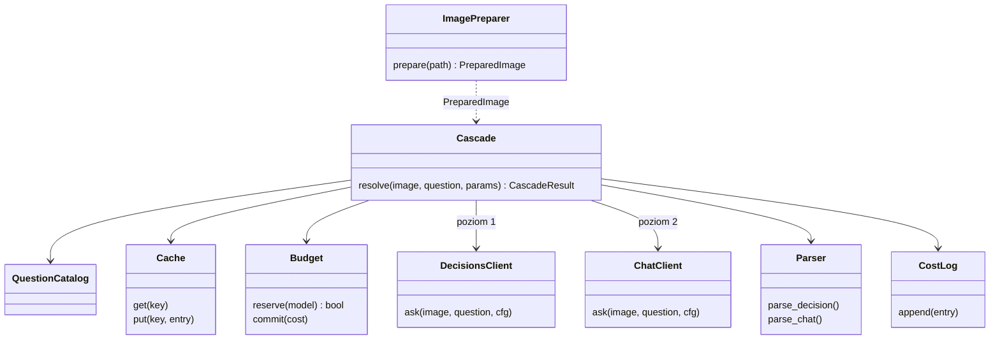
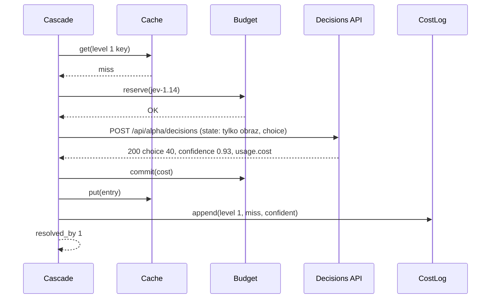
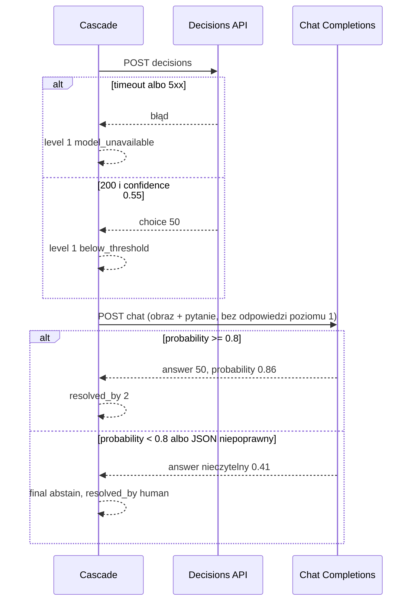
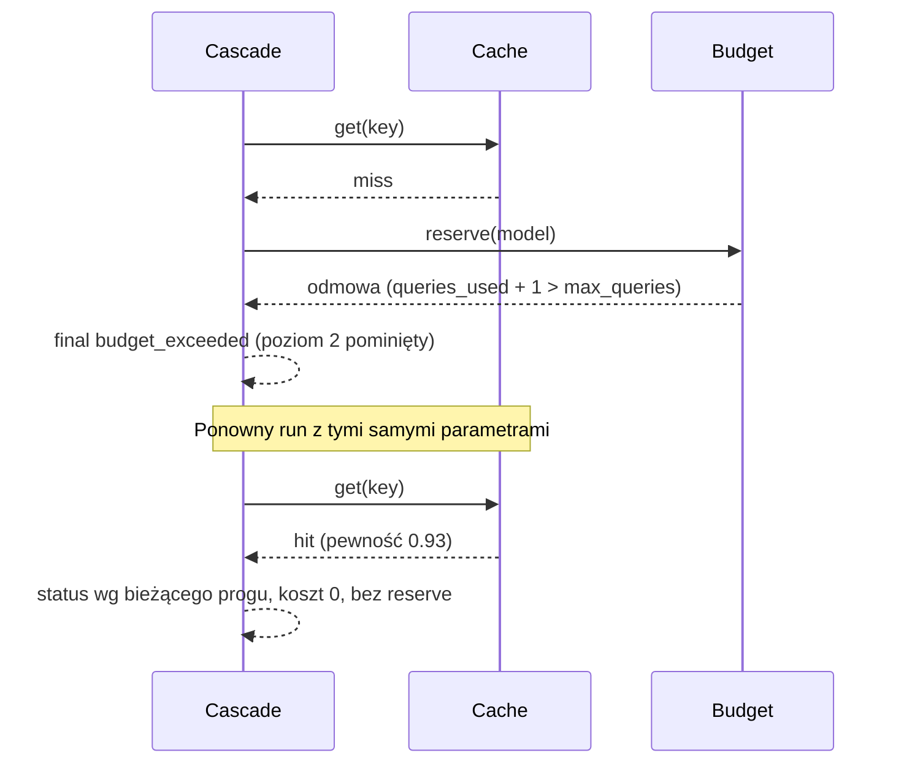

# ADR-003: Kaskada modeli — kontrakt, budżet, cache

**Data:** 2026-11-03
**Status:** Accepted
**Dotyczy:** [`000-main-architecture.md`](000-main-architecture.md)
**PRD:** F5, F1.4, F1.5, §6 (cache), §7 (koszt)

---

## 1. Zakres

Obejmuje: katalog pytań i dozwolonych odpowiedzi, przygotowanie obrazu (limity Jev, `image_out_of_bounds`), kontrakt żądań do OpenRouter Decisions API (poziom 1, model porównawczy) i Chat Completions (poziom 2), parsowanie i klasyfikację wyników, progi i eskalację, budżet zapytań i kosztu, cache, log kosztów, timeouty i brak ponowień, nagrania prawdziwych odpowiedzi.

Nie obejmuje: reguł kandydatów i kolejki (ADR-004), metryk ewaluacji (ADR-004).

---

## 2. Odniesienia do dokumentacji

Źródło: Context7 `/openrouterteam/docs` (przewodniki „Multimodal Decisions”, „Jev”, cookbook „jev-classification”, „jev-verified-cascade”, „usage-accounting”, OpenAPI), odczyt 2026-11-03.

| Usługa / biblioteka | Context7 ID albo dokumentacja | Zastosowanie |
|---|---|---|
| OpenRouter Decisions API | `/openrouterteam/docs`; https://openrouter.ai/docs/api/api-reference/alphadecisions/submit-a-decisions-request.md | `POST https://openrouter.ai/api/alpha/decisions` |
| OpenRouter Chat Completions | `/openrouterteam/docs`; https://openrouter.ai/docs/api/api-reference/chat/create-a-chat-completion.md | `POST https://openrouter.ai/api/v1/chat/completions` |
| OpenRouter limity i błędy | https://openrouter.ai/docs/api_reference/limits.md | 402/429, nagłówki `X-RateLimit-*` |
| httpx 0.28.1 | https://www.python-httpx.org/ | Klient, timeout, brak ponowień |
| respx 0.23.1 | https://lundberg.github.io/respx/ | Mock w testach integracyjnych |
| Pillow 13.0.0 | https://pillow.readthedocs.io/en/stable/ | Przygotowanie obrazu |
| sqlite3 (stdlib) | https://docs.python.org/3.12/library/sqlite3.html | Cache |

Fakty zweryfikowane i użyte w decyzjach:
- Decisions: wymagane `model`, `state`, `questions`; opcjonalnie `assets`, `provider`, `session_id`, `user`, `trace`. Typy pytań: `noul` (prawdopodobieństwo 0–1), `choice` (`instructions` + `criteria`: etykieta → opis), `score`, `box`.
- Odpowiedź `choice`: `answers.<id>` = `{type, choice, confidence?, probabilities?}`; `confidence` i `probabilities` są **opcjonalne**. `usage`: `input_tokens`, `output_tokens`, opcjonalnie `cost` (USD).
- API Decisions **nie ma** progu, abstencji ani timeoutu — są po stronie klienta.
- Obraz w Decisions — dokumentacja podaje **dwa** formaty: część `{type: image_url, image_url: {url: data:...}}` w tablicy `state` (przewodnik Multimodal Decisions) oraz `assets.<klucz> = {type: image, format, data_base64}` z odwołaniem do klucza w `state` (OpenAPI). Format rozstrzyga nagranie (D-003-6).
- Modele Decisions przyjmujące obrazy obejmują `openai/gpt-6-luna-decisions` i `typesafe/jev-1.14` (lista w „Multimodal Decisions”).
- Jev 1.13/1.14 (przewodnik „Jev”): tylko PNG/JPEG; 256–1568 px na bok; 78 400–2 458 624 px łącznie; 16 MiB na plik; 32 MiB na body; brak obrotu według EXIF. Prawdopodobieństwa różnych modeli nie są porównywalne, więc progi ustawia się osobno dla każdego modelu (przyjęte za wersją referencyjną prowadzącego, ADR-003 §2).
- Chat: `reasoning: {effort: "medium"}` (enum: `max`, `xhigh`, `high`, `medium`, `low`, `minimal`, `none`); obraz jako część `image_url` z `data:` URL; `response_format` typu `json_schema` (`name`, `schema`, `strict`); `usage` z `prompt_tokens`, `completion_tokens`, `cost`, `completion_tokens_details.reasoning_tokens`.
- Błędy (OpenAPI): 400, 401, 402, 403, 404, 413, 429, 500, 502, 503, 524, 529; ciało `{error: {code, message, metadata}}`.
- Cennik według prowadzącego (12.11.2026): `typesafe/jev-1.14` 0,042 USD/mln tokenów wejścia, wyjście 0 USD, kontekst 262K; `openai/gpt-6-luna-decisions` 0,10 USD/mln tokenów wejścia, wyjście 0 USD, kontekst 1,1M. `gpt-6-luna` (poziom 2): **niepotwierdzony**, ustala go nagranie (D-003-6) i `usage.cost`.

---

## 3. Projekt komponentów

### 3.1 Katalog pytań (`questions`)

Każde pytanie ma: `question_id`, `attribute`, `prompt_version`, `text` (neutralne pytanie zamknięte po polsku), `options` (lista etykiet z PRD F5.2), `value_options` (podzbiór niosący wartość — ADR-000 D10-I1), mapowanie etykiet referencyjnych.

| `question_id` | Atrybut | Tekst | `options` | `value_options` | Mapowanie etykiet |
|---|---|---|---|---|---|
| `speed_limit_value` | `speed_limit` | „Jaka wartość jest na znaku ograniczenia prędkości?” | `20`, `30`, `40`, `50`, `60`, `70`, `80`, `90`, `100`, `110`, `120`, `140`, `brak znaku`, `nieczytelny` | liczby | `none` → `brak znaku`, `unreadable` → `nieczytelny`, liczba → ta sama |
| `surface_paved` | `surface` | „Czy nawierzchnia drogi w kadrze jest utwardzona?” | `utwardzona`, `nieutwardzona`, `nie widać` | `utwardzona`, `nieutwardzona` | `paved` → `utwardzona`, `unpaved` → `nieutwardzona` |
| `street_lamp_visible` | `lit` | „Czy w kadrze widać oprawę lampy ulicznej?” | `tak`, `nie`, `nie widać` | `tak`, `nie` | `yes` → `tak`, `no` → `nie` |

Opisy kryteriów (`criteria`) to krótkie, neutralne definicje etykiet (np. dla `nieczytelny`: „Znak ograniczenia prędkości jest w kadrze, ale wartości nie da się odczytać”). Zmiana tekstu, opcji lub opisów = nowy `prompt_version` (np. `speed_limit_value.v2`), co unieważnia cache tylko dla tego pytania.

### 3.2 Przygotowanie obrazu

Przygotowanie musi spełnić wymagania obrazów Jev (`typesafe/jev-1.14`, model domyślny poziomu 1): tylko PNG/JPEG, 256–1568 px na bok, 78 400–2 458 624 px łącznie, ≤ 16 MiB na plik, model **nie** obraca obrazu według EXIF (przyjęte za wersją referencyjną prowadzącego, ADR-003 §2, §3.2, D-34). Jeden przygotowany obraz na plik źródłowy trafia do **wszystkich** modeli i poziomów (poziom 1, poziom 2, model porównawczy), aby porównanie modeli mierzyło to samo wejście, także po zamianie poziomu 1 Jev ↔ Luna decisions.

Kroki (`ImagePreparer`, Pillow 13.0.0):
1. Wejście: plik obrazu z `DataBundle` (wycinek `signs/crops/` albo pełny kadr). Format inny niż PNG/JPEG → `image_out_of_bounds` (bez konwersji formatu).
2. `ImageOps.exif_transpose` — fizyczny obrót według orientacji EXIF (Jev ignoruje znacznik orientacji).
3. Skalowanie z zachowaniem proporcji, filtr `LANCZOS`: gdy krótszy bok < 256 px — powiększenie do 256 px (małe wycinki znaków); gdy dłuższy bok > 1568 px — zmniejszenie do 1568 px.
4. Kontrola po skalowaniu: każdy bok w 256–1568 px, liczba pikseli w 78 400–2 458 624. Niespełnienie (np. skrajne proporcje wycinka, przy których powiększenie krótszego boku wypycha dłuższy ponad 1568 px) → obraz odrzucony ze statusem `image_out_of_bounds`; żadne zapytanie nie jest wysyłane.
5. Zapis JPEG, jakość 92, bez EXIF i innych metadanych (usuwa też ewentualne GPS). Wynik > 16 MiB → `image_out_of_bounds`.

- `PreparedImage` zawiera **wyłącznie** bajty i typ MIME (`image/jpeg`) oraz `sha256` pliku źródłowego (do cache, nie wysyłany) i wymiary oryginału (do raportu, nie wysyłane). Nazwa pliku, `photo_id`, ścieżka i metadane nie są częścią obiektu, więc nie mogą trafić do żądania (F5.1).
- Wersja przygotowania (`image_prep.v2`; `v1` = wycinki bez zmian, kadry ≤ 1024 px, JPEG 90) wchodzi do `prompt_version` w kluczu cache, więc zmiana przygotowania unieważnia wcześniejsze wpisy.
- `image_out_of_bounds` to końcowy status pytania (`CascadeResult.final_status`, `resolved_by = human`), bez wpisu w cache i bez zużycia budżetu; pytanie trafia do kolejki ręcznej jak inne nierozstrzygnięte odczyty (ADR-004 §3.4). Raport pokazuje oryginalny rozmiar obrazu.

### 3.3 Kontrakt żądań

**Poziom 1 i model porównawczy — Decisions API:**
- `model`: poziom 1 domyślnie `typesafe/jev-1.14` (nadpisywalne: konfiguracja > `DECISION_MODEL` > domyślna); porównawczy domyślnie `openai/gpt-6-luna-decisions` (ADR-000 D9).
- `questions`: jeden wpis `<question_id>` typu `choice`, `instructions` = tekst pytania, `criteria` = `options` z opisami.
- `state`: **tylko obraz** (część obrazowa albo odwołanie do `assets`, zgodnie z formatem z nagrania). Bez tekstu kontekstowego: bez tagów mapy, etykiet, detekcji Mapillary, identyfikatorów, nazw plików, wartości OSM/Overture.
- Nie wysyłamy `session_id`, `user`, `trace`, `provider` (pola mogłyby nieść identyfikatory).

**Poziom 2 — Chat Completions:**
- `model`: domyślnie `openai/gpt-6-luna` (nadpisywalne: konfiguracja > `LLM_MODEL` > domyślna), `reasoning.effort` = `medium` (konfigurowalne).
- `messages`: jedna wiadomość `user` z częścią tekstową (tekst pytania + lista dozwolonych odpowiedzi + instrukcja: „Odpowiedz wyłącznie w formacie JSON zgodnym ze schematem. `probability` to Twoje prawdopodobieństwo, że odpowiedź jest poprawna.”) i częścią `image_url` z `data:` URL.
- `response_format`: `json_schema`, `strict = true`, schemat: obiekt z wymaganymi polami `answer` (enum = `options`) i `probability` (liczba 0–1), bez dodatkowych pól.
- Brak odpowiedzi poziomu 1 w żądaniu (F5.1, kryterium 7); brak historii rozmowy; brak wiadomości systemowej z kontekstem.
- `max_tokens` konfigurowalne (domyślnie 2048), aby ograniczyć koszt tokenów rozumowania; nazwę i zachowanie parametru potwierdza nagranie.

**Wspólne:** nagłówek `Authorization: Bearer <OPENROUTER_API_KEY>` ustawiany wyłącznie w kliencie; nagłówki `HTTP-Referer`/`X-Title` nie są wysyłane. Klient `httpx.Client` z `timeout` = 60 s (konfigurowalny), transport bez ponowień, jeden obiekt klienta na run.

### 3.4 Parsowanie i klasyfikacja wyniku

| Sytuacja | `ModelAttempt.status` |
|---|---|
| HTTP 200, `choice`/`answer` ∈ `options`, pewność ≥ progu | `confident` |
| HTTP 200, poprawna odpowiedź, pewność < progu | `below_threshold` |
| HTTP 200, odpowiedź spoza `options`, brak pola, JSON niezgodny ze schematem, pewność spoza [0, 1], brak pewności | `invalid_response` |
| HTTP 4xx (poza 402 z limitu budżetu konta), 5xx, timeout, błąd połączenia | `model_unavailable` (`error_class` = kod HTTP albo `timeout`/`connect_error`) |
| HTTP 402 (brak środków / limit konta) | `model_unavailable` z `error_class = "402"`; run kontynuuje, kolejne wywołania tego modelu w runie są pomijane jako `model_unavailable` bez zapytania (bezpiecznik) |
| Odmowa budżetu przed wysłaniem | `budget_exceeded` |

**Pewność poziomu 1:** `confidence`; gdy brak — `probabilities[choice]`; gdy brak obu — `invalid_response` (nie zakładamy 0, aby odróżnić błąd formatu od niskiej pewności). **Pewność poziomu 2:** pole `probability` (deklarowane przez model).

Odpowiedzi `nie widać`, `nieczytelny`, `brak znaku` z pewnością ≥ progu są `confident` (F5.4).

### 3.5 Orkiestracja kaskady

1. Poziom 1: cache → budżet → wywołanie. `confident` → koniec, `resolved_by = 1`.
2. `below_threshold`, `invalid_response`, `model_unavailable` → poziom 2 z `escalation_reason`. `budget_exceeded` na poziomie 1 → koniec, `final_status = budget_exceeded` (poziom 2 nie jest wywoływany).
3. Poziom 2: cache → budżet → wywołanie. `confident` → `resolved_by = 2`.
4. W przeciwnym razie `resolved_by = human` i `final_status`:
   - `model_unavailable`, gdy oba poziomy `model_unavailable`;
   - `budget_exceeded`, gdy poziom 2 dostał odmowę budżetu;
   - `abstain` w pozostałych przypadkach.
5. Tryb `--no-model`: kaskada nie jest uruchamiana, `final_status = skipped_no_model`; klient HTTP nie jest tworzony, klucz API nie jest wymagany.
6. Wyjątek w jednym pytaniu (np. uszkodzony obraz) = `invalid_response` z `error_class`; run kontynuuje (F5.7).
7. Obraz odrzucony przy przygotowaniu (§3.2) → `final_status = image_out_of_bounds`, `resolved_by = human`, żaden poziom nie jest wywoływany.

Progi: `thresholds.<level>.<model>.<attribute>` (np. `thresholds.level1."typesafe/jev-1.14".speed_limit`), domyślnie 0,8 (F5.6). Porównanie `≥`. Próg jest przypisany do pary poziom × model, bo prawdopodobieństwa różnych modeli nie są porównywalne (przyjęte za wersją referencyjną prowadzącego, ADR-003 §2, §5.7). Zamiana modelu poziomu 1 (Jev ↔ `openai/gpt-6-luna-decisions`) nie przenosi progu skalibrowanego dla drugiego modelu: brak wpisu dla wybranego modelu = wartość domyślna 0,8 z ostrzeżeniem „próg niekalibrowany dla modelu” w raporcie i `run.json`. Model porównawczy (F5.11) ma własne progi `thresholds.compare.<model>.<attribute>`.

### 3.6 Budżet

- Liczniki na run: `queries_used` (liczba wysłanych żądań HTTP do OpenRouter, łącznie poziom 1, poziom 2 i model porównawczy — ADR-000 D10-I5), `cost_used_usd` (Decimal).
- Przed wysłaniem: odmowa, gdy `queries_used + 1 > max_queries` albo `cost_used_usd + reserve_usd(model) > max_usd`. `reserve_usd(model)` z konfiguracji `models.<model>.reserve_usd`; wartość domyślna = 0,01 USD do czasu nagrania (D-003-6), potem ustawiana na 2× zmierzony koszt zapytania.
- Po odpowiedzi: `cost_used_usd += usage.cost`; gdy brak `usage.cost` — dodajemy `reserve_usd` i zapisujemy `cost_estimated = true`. Wywołanie zakończone błędem HTTP liczy się jako zapytanie; koszt 0, chyba że odpowiedź podaje `usage.cost`.
- Trafienie w cache nie zmienia liczników (F5.8).

### 3.7 Cache

- Plik: `<cache_dir>/llm_cache.sqlite`, domyślnie `course-materials/exercise-data/map-qa/data/cache/` (F2.2), nadpisywalne w konfiguracji.
- Klucz: `level` + `sha256(obraz źródłowy)` + `question_id` + `model` + `reasoning_effort` (pusty dla poziomu 1) + `prompt_version` (w tym `image_prep`). Klucz zapisany jako kolumny i jako `sha256` złączenia (klucz główny).
- Zapisywane są wyniki `confident`, `below_threshold`, `invalid_response` (deterministyczne dla tego samego żądania). **Nie** są zapisywane `model_unavailable` ani `budget_exceeded` (ponowny run spróbuje ponownie).
- Wartość: sparsowana odpowiedź, pewność, status, `usage`, pełne ciało odpowiedzi HTTP (bez nagłówków), `created_at`. Bez treści obrazu, bez klucza API.
- Próg nie jest częścią klucza: zmiana progu przelicza status `confident`/`below_threshold` z zapisanej pewności bez nowego zapytania.

### 3.8 Log kosztów

`reports/map-qa/<run_id>/costs.jsonl`, jeden wiersz na próbę (także cache hit i odmowę budżetu), pola `CostLogEntry` (ADR-000 §5). Bez sekretów, bez obrazu, bez treści odpowiedzi modelu poza etykietą i pewnością.

---

## 4. Struktury danych

- `Question`, `PreparedImage`, `ModelAttempt`, `CascadeResult`, `CacheEntry`, `CostLogEntry` — ADR-000 §5 i §3 powyżej.
- `ModelConfig`: `id`, `endpoint` (`decisions` \| `chat`), `reasoning_effort` (\| null), `reserve_usd`, `timeout_s`, `max_tokens` (chat).
- `BudgetState`: `max_queries`, `max_usd`, `queries_used`, `cost_used_usd`, `refusals` (licznik), `disabled_models` (zbiór, bezpiecznik 402).
- `Capture` (nagranie): `captured_at` (UTC), `endpoint`, `model`, `request_summary` (struktura żądania z obrazem zastąpionym `<IMAGE sha256=...>`), `status`, `headers` (bez `Authorization`, `Set-Cookie`), `body` (dosłownie), `notes`.

---

## 5. Kontrakty interfejsów

| Interfejs | Wejście | Wyjście | Błędy |
|---|---|---|---|
| `DecisionsClient.ask` | `PreparedImage`, `Question`, `ModelConfig` | surowa odpowiedź + `usage` + czas | `ModelUnavailable` (HTTP, timeout) |
| `ChatClient.ask` | `PreparedImage`, `Question`, `ModelConfig` | jak wyżej | jak wyżej |
| `parse_decision` / `parse_chat` | surowa odpowiedź, `Question`, próg | `ModelAttempt` | — (błędy formatu → `invalid_response`) |
| `Cascade.resolve` | `PreparedImage`, `Question`, `RunParams` | `CascadeResult` | brak (wszystkie błędy zamienione na statusy) |
| `Budget.reserve` / `Budget.commit` | model, koszt | zgoda / odmowa | — |
| `Cache.get` / `Cache.put` | klucz / wpis | `CacheEntry` \| brak | błąd I/O SQLite → run kończy się kodem 1 (uszkodzony cache) |

Sygnatury klientów przyjmują tylko `PreparedImage` i `Question` — nie ma parametru, przez który mogłyby trafić tagi, etykiety ani identyfikatory (izolacja przez typ, kryterium 6).

---

## 6. Decyzje techniczne

### D-003-1. Typ pytania `choice` dla wszystkich atrybutów
**Status:** Accepted
**Data:** 2026-11-03
**Kontekst:** F5.2 definiuje 3–14 zamkniętych odpowiedzi; F5.3 wymaga odpowiedzi i prawdopodobieństwa.
**Decyzja:** `choice` z `criteria` = dozwolone odpowiedzi; pewność z `confidence` albo `probabilities[choice]`.
**Odrzucone alternatywy:**
- `noul` dla oświetlenia i nawierzchni: tylko tak/nie, brak `nie widać`.
- `score` dla prędkości: wartość ciągła zamiast zamkniętej listy, trudna walidacja.
**Konsekwencje:**
- (+) Jeden parser i jedna reguła progu.
- (-) `confidence` opcjonalne — brak obu pól = `invalid_response` i eskalacja.
**Warunek rewizji:** Gdy nagranie pokaże, że model nie zwraca `confidence` ani `probabilities` dla `choice`.

### D-003-2. Poziom 2: Chat Completions ze schematem JSON i deklarowaną pewnością
**Status:** Accepted
**Data:** 2026-11-03
**Kontekst:** Zwykły LLM nie ma typowanej odpowiedzi jak Decisions; PRD wymaga prawdopodobieństwa i `invalid_response`.
**Decyzja:** `response_format: json_schema` (strict) z `answer` (enum) i `probability`; reasoning `medium`. Pewność deklarowana przez model; jakość kontrolujemy osobną trafnością poziomu 2 na eskalowanych pytaniach i kalibracją progu (PRD §7).
**Odrzucone alternatywy:**
- Logprobs tokenu odpowiedzi: wiele modeli z rozumowaniem nie zwraca logprobs; brak gwarancji u dostawców OpenRouter.
- Wolny tekst z parsowaniem regex: kruche, więcej `invalid_response`.
**Konsekwencje:**
- (+) Walidacja odpowiedzi po stronie API i klienta.
- (-) Deklarowana pewność bywa zawyżona — ryzyko z PRD §10; łagodzi je priorytet `średni` i próg z kalibracji.
**Warunek rewizji:** Gdy trafność poziomu 2 na eskalowanych pytaniach < 90% po kalibracji (PRD §7).

### D-003-3. Brak ponowień; jedno żądanie HTTP = jedno zapytanie w budżecie
**Status:** Accepted
**Data:** 2026-11-03
**Kontekst:** Ponowienia ukryte w kliencie zużywają budżet i psują log kosztów; eskalacja do poziomu 2 już pełni rolę „drugiej próby”.
**Decyzja:** `httpx` bez ponowień; błąd poziomu 1 → eskalacja, błąd poziomu 2 → kolejka ręczna. Bezpiecznik 402 wyłącza model do końca runu.
**Odrzucone alternatywy:**
- Retry 429/5xx z backoff (jak w cookbook OpenRouter): lepsza dostępność, ale niejawny koszt i niedeterministyczny log.
**Konsekwencje:**
- (+) Budżet i log dokładnie odpowiadają wysłanym żądaniom (kryterium 9).
- (-) Przejściowe awarie zwiększają eskalacje; łagodzi to cache przy kolejnym runie.
**Warunek rewizji:** Gdy `model_unavailable` > 5% zapytań w runie z powodu 429/5xx.

### D-003-4. Cache bez progu w kluczu; błędy transportu nie są cache'owane
**Status:** Accepted
**Data:** 2026-11-03
**Kontekst:** Kalibracja progu (PRD §7) wymaga wielokrotnego przeliczenia wyników bez kosztu; ponowny run musi kosztować 0 USD (NFR).
**Decyzja:** Cache przechowuje pewność, status przeliczany przy odczycie względem bieżącego progu; `model_unavailable` i `budget_exceeded` nie są zapisywane.
**Odrzucone alternatywy:**
- Próg w kluczu: każda zmiana progu = nowe płatne zapytania.
- Cache'owanie błędów: run po awarii nie spróbowałby ponownie.
**Konsekwencje:**
- (+) Kalibracja i ponowne raporty bez kosztu.
- (-) Run po awarii API może kosztować więcej niż poprzedni.
**Warunek rewizji:** Gdy model zacznie zwracać różne odpowiedzi dla tego samego żądania (brak determinizmu) i potrzebne będzie wielokrotne próbkowanie.

### D-003-5. Rezerwacja kosztu przed zapytaniem
**Status:** Accepted
**Data:** 2026-11-03
**Kontekst:** Koszt znamy dopiero z `usage.cost` po odpowiedzi; cennik modeli niepotwierdzony; limit 1,00 USD nie może zostać przekroczony.
**Decyzja:** Odmowa, gdy suma kosztów + rezerwa modelu > limit. Rezerwa z konfiguracji, domyślnie 0,01 USD, po nagraniu 2× zmierzony koszt.
**Odrzucone alternatywy:**
- `provider.max_price` w żądaniu: dostępne w Chat, ale nie obejmuje tokenów rozumowania ani nie jest opisane dla Decisions.
- Sprawdzanie limitu tylko po fakcie: ostatnie zapytanie może przekroczyć limit.
**Konsekwencje:**
- (+) Twarda gwarancja limitu przy poprawnej rezerwie.
- (-) Zbyt wysoka rezerwa kończy run wcześniej (widoczne jako `budget_exceeded` w raporcie).
**Warunek rewizji:** Gdy OpenRouter udostępni koszt szacowany przed wysłaniem albo limit kosztu per żądanie dla Decisions.

### D-003-6. Nagranie prawdziwych odpowiedzi przed implementacją klientów
**Status:** Accepted (wykonanie wymaga zgody użytkownika w momencie implementacji)
**Data:** 2026-11-03
**Kontekst:** AGENTS.md wymaga mocków z prawdziwych odpowiedzi; dokumentacja podaje dwa formaty obrazu w Decisions; cennik jest niepotwierdzony.
**Decyzja:** Przed napisaniem `DecisionsClient`/`ChatClient` implementujący agent prosi użytkownika o zgodę i wykonuje skrypt nagrywający (`app/scripts/capture_openrouter.py`, poza pakietem runtime) z limitem **6 zapytań i 0,05 USD**: po 1–2 zapytania do `openai/gpt-6-luna-decisions` (oba formaty obrazu), `typesafe/jev-1.14`, `openai/gpt-6-luna` (reasoning `medium`) na jednym wycinku `signs/crops/` (licencja CC BY-SA, bez danych osobowych). Wynik w `app/tests/fixtures/captures/openrouter/*.json` z metadanymi i redakcją nagłówków. Skrypt odczytuje klucz ze zmiennej środowiskowej i nigdy go nie wypisuje.
**Odrzucone alternatywy:**
- Mock z dokumentacji: AGENTS.md tego zabrania; dwa sprzeczne formaty.
**Konsekwencje:**
- (+) Rozstrzyga format obrazu, nazwę `max_tokens`, obecność `confidence` i realny koszt.
- (-) Niewielki koszt i potrzeba zgody.
**Warunek rewizji:** Każda zmiana modelu, endpointu albo `prompt_version` struktury żądania wymaga nowego nagrania.

### D-003-7. Wspólny przygotowany obraz zgodny z limitami Jev
**Status:** Accepted
**Data:** 2026-11-12
**Kontekst:** Poziom 1 to `typesafe/jev-1.14`, który przyjmuje tylko PNG/JPEG 256–1568 px na bok (78 400–2 458 624 px łącznie, ≤ 16 MiB) i nie obraca obrazu według EXIF. Wycinki znaków bywają mniejsze niż 256 px. Poprzednie przygotowanie (`image_prep.v1`) wysyłało wycinki bez zmian.
**Decyzja:** Jedna transformacja dla wszystkich modeli i poziomów: `exif_transpose`, powiększenie Lanczos do 256 px krótszego boku, zmniejszenie do 1568 px dłuższego boku, JPEG q92 bez metadanych; obraz poza zakresem → `image_out_of_bounds` (§3.2). Wersja `image_prep.v2` w kluczu cache. Progi per poziom × model (§3.5). Przyjęte za wersją referencyjną prowadzącego (ADR-003 D-34).
**Odrzucone alternatywy:**
- Oryginalne bajty dla Luna i przeskalowane dla Jev: porównanie modeli mierzyłoby różne wejścia.
- Odrzucanie małych wycinków zamiast powiększania: większość wycinków `signs/crops/` wypadłaby z ewaluacji.
**Konsekwencje:**
- (+) Uczciwe porównanie modeli, usunięte metadane, brak błędów 400 z powodu rozmiaru.
- (-) Powiększone wycinki mogą być rozmyte; raport pokazuje oryginalny rozmiar.
- (-) Wpisy cache z `image_prep.v1` nie są używane (jednorazowy koszt ponownych zapytań).
**Warunek rewizji:** Gdy dokumentacja Jev zmieni limity obrazów albo poziom 1 przejdzie na model bez takich limitów.

---

## 7. Diagramy

### Diagram komponentów

### Sekwencja: poziom 1 pewny (poziom 2 niewywoływany)

### Sekwencja: eskalacja i przekazanie człowiekowi

### Sekwencja: budżet wyczerpany i cache przy ponownym runie

---

## 8. Strategia testów

Testy integracyjne klientów używają wyłącznie nagrań z D-003-6 (respx). Testy jednostkowe kaskady zastępują klientów atrapami zwracającymi `ModelAttempt`.

| Scenariusz | Typ | Wejście | Oczekiwany wynik | Przypadki brzegowe |
|---|---|---|---|---|
| ISO-01 izolacja żądania | Integration | żądanie z poziomu 1 i 2 przechwycone przez respx | ciało zawiera tylko: model, pytanie, opcje, opisy, obraz (base64); brak `photo_id`, nazwy pliku, tagów, etykiet, wartości OSM, `mapillary_value` (przeszukanie całego JSON) — kryterium 6 | zdjęcie o nazwie zawierającej liczbę `50` |
| ISO-02 poziom 2 niezależny | Integration | poziom 1 zwraca `40` z p=0,5 | żądanie poziomu 2 nie zawiera `40` jako odpowiedzi ani `0.5` | — |
| CAS-01 poziom 1 pewny | Unit | p=0,93 | 1 wywołanie, `resolved_by=1`, poziom 2 niewywołany | p = dokładnie 0,8 → pewny |
| CAS-02 eskalacje | Unit | p=0,5 / `invalid_response` / HTTP 500 / timeout | wywołany poziom 2, przy pewnym — `resolved_by=2` | `escalation_reason` zgodny z przyczyną |
| CAS-03 abstencja | Unit | oba poziomy < progu | `abstain`, `resolved_by=human` | poziom 2 `invalid_response` |
| CAS-04 oba niedostępne | Unit | oba HTTP 503 | `model_unavailable` | poziom 1 503, poziom 2 timeout |
| CAS-05 odpowiedzi bez wartości | Unit | `brak znaku` p=0,95 | `confident`, bez eskalacji (F5.4) | `nie widać` p=0,79 → eskalacja |
| PAR-01 parsowanie Decisions | Integration | nagranie 200 | poprawne `choice`, pewność z `confidence` | brak `confidence` → `probabilities`; brak obu → `invalid_response`; `choice` spoza listy |
| PAR-02 parsowanie Chat | Integration | nagranie 200 | `answer`, `probability` | `probability` = 1,2; brak pola; tekst zamiast JSON |
| ERR-01 kody HTTP | Integration | 400, 401, 402, 429, 500, 524 (ciało w formacie z OpenAPI; status i ciało z nagrania błędu, jeśli dostępne) | `model_unavailable` z `error_class`; 402 wyłącza model | brak ciała |
| ERR-02 brak ponowień | Integration | 429 | dokładnie 1 żądanie na poziom (licznik respx) | — |
| BUD-01 limit zapytań | Unit | `max_queries=5`, 20 pytań, wszystkie eskalują | ≤ 5 żądań łącznie, reszta `budget_exceeded` (kryterium 9) | limit osiągnięty między poziomem 1 a 2 |
| BUD-02 limit kosztu | Unit | `max_usd=0.02`, rezerwa 0,01 | brak zapytania, które przekroczyłoby limit | brak `usage.cost` → rezerwa, `cost_estimated` |
| CAC-01 ponowny run | Integration | dwa runy, ten sam cache | drugi run 0 żądań HTTP, `costs.jsonl` bez `miss`, koszt 0 (kryterium 8) | zmiana progu → 0 żądań, inny status |
| CAC-02 klucz | Unit | zmiana modelu / effort / `prompt_version` / obrazu / wersji `image_prep` | inny klucz | ten sam obraz, inna nazwa pliku → ten sam klucz |
| IMG-01 przygotowanie obrazu | Unit | wycinek 120×140 px; kadr 4000×3000 px; JPEG z orientacją EXIF 6 | krótszy bok 256 px; dłuższy bok 1568 px; poprawna orientacja; wynik JPEG q92 bez EXIF | wynik w granicach 256–1568 px na bok i 78 400–2 458 624 px |
| IMG-02 `image_out_of_bounds` | Unit | wycinek 40×400 px (po powiększeniu dłuższy bok > 1568); plik GIF | `final_status = image_out_of_bounds`, 0 żądań HTTP, brak wpisu w cache, pozycja kolejki przy drodze OSM | plik > 16 MiB po zapisie |
| IMG-03 ten sam obraz dla modeli | Unit | pytanie eskalowane do poziomu 2 i tryb porównawczy | bajty obrazu w żądaniu poziomu 1, poziomu 2 i modelu porównawczego są identyczne | — |
| THR-01 progi per model | Unit | próg `level1.jev.speed_limit = 0.9`, poziom 1 przełączony na `openai/gpt-6-luna-decisions` | użyty próg domyślny 0,8 z ostrzeżeniem „próg niekalibrowany”, nie 0,9 | `--threshold-l1` nadpisuje próg tylko dla bieżącego modelu |
| CAC-03 błędy poza cache | Unit | `model_unavailable` | brak wpisu w cache | — |
| LOG-01 log kosztów | Unit | run z 3 pytaniami | 1 wiersz na próbę, wszystkie pola F5.10, brak klucza API i base64 | cache hit ma koszt 0 |
| SEC-01 sekret | Integration | `OPENROUTER_API_KEY=TEST_SECRET_...` | sekret tylko w nagłówku żądania; brak w logach, cache, nagraniach, wyjątkach | wyjątek httpx z requestem w repr |
| NOM-01 `--no-model` | Unit | brak klucza API | brak klienta HTTP, `skipped_no_model` | — |
| PAID-01 prawdziwy run | E2E `paid` | 119 wycinków, limity domyślne | raport powstaje, koszt ≤ 1 USD, ≤ 200 zapytań; drugi run 0 zapytań | — |

### Techniczne kryteria akceptacji

- TAC-003-01: Każdy test klienta HTTP wskazuje plik nagrania z `captures/openrouter/` (TAC-07).
- TAC-003-02: Liczba żądań HTTP w każdym teście kaskady jest równa liczbie wpisów `cache=miss` ze statusem innym niż `budget_exceeded` w `costs.jsonl`.
- TAC-003-03: Suma `cost_usd` w `costs.jsonl` ≤ `max_usd` w każdym teście budżetu, także z brakującym `usage.cost`.
- TAC-003-04: Ciało żądania nie zawiera żadnego ciągu z listy zakazanej (identyfikatory, nazwy plików, tagi, etykiety, wartości mapy) — test parametryzowany na 10 losowych (stały seed) zdjęciach danych kursu.
- TAC-003-05: Zmiana progu w konfiguracji i ponowny run na ciepłym cache wykonuje 0 żądań HTTP.
