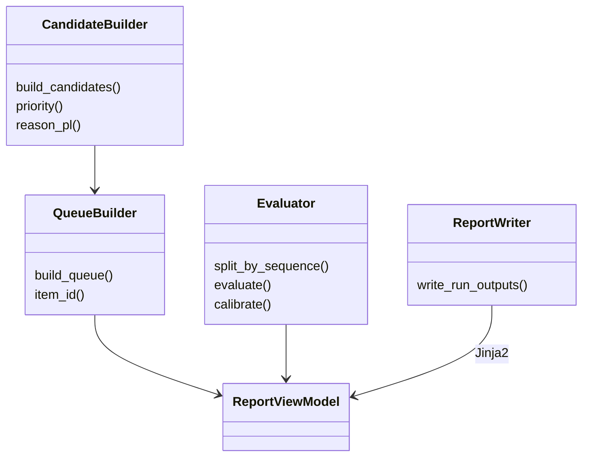
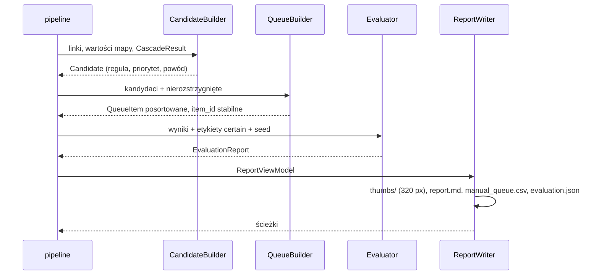
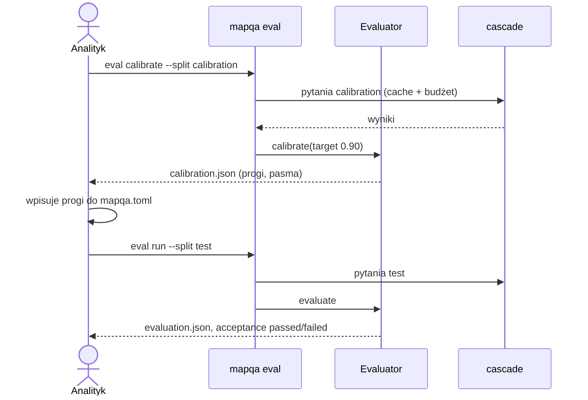

# ADR-004: Kandydaci, kolejka ręczna, raport i ewaluacja

**Data:** 2026-11-03
**Status:** Accepted
**Dotyczy:** [`000-main-architecture.md`](000-main-architecture.md)
**PRD:** F6, F7, §7, §9 (kryteria MVP)

---

## 1. Zakres

Obejmuje: reguły kandydatów rozbieżności i priorytety (F6.1–F6.4), kolejkę ręczną `manual_queue.csv` (F6.5–F6.7), układ katalogu runu, raport Markdown [MVP] i HTML [P4], atrybucję i licencje (F7.5), `evaluation.json`, podział kalibracja/test, metryki i kalibrację progów (PRD §7).

Nie obejmuje: samej kaskady (ADR-003), normalizacji (ADR-002).

---

## 2. Odniesienia do dokumentacji

| Biblioteka / źródło | Context7 ID albo dokumentacja | Zastosowanie |
|---|---|---|
| Jinja2 3.1.6 | https://jinja.palletsprojects.com/en/stable/ | Szablony `report.md.j2`, `report.html.j2`; autoescape dla HTML |
| Pillow 12.0.0 | https://pillow.readthedocs.io/en/stable/ | Miniatury 320 px (wersja jak w danych kursu, ADR-000 §2) |
| pandas 3.1.0 | https://pandas.pydata.org/docs/ | Zapis CSV, agregacje metryk |
| Atrybucja danych | `course-materials/exercise-data/map-qa/ATTRIBUTION.md` | Tekst licencji ODbL / CC BY-SA w raporcie |
| OpenRouter cookbook „jev-classification” | `/openrouterteam/docs` | Kalibracja progu po pasmach pewności na próbie z etykietami |

---

## 3. Projekt komponentów

### 3.1 Reguły kandydatów (F6.1 z interpretacją ADR-000 D10)

Wejście: `PhotoRoadLink` (z `osm_way_id` nie null), `AttributeValue` OSM (i Overture od P3), `CascadeResult`. „Pewny odczyt wartości” = `final_status = resolved` **i** `final_answer ∈ value_options` pytania (ADR-003 §3.1).

| Reguła | Warunek | Priorytet |
|---|---|---|
| `photo_vs_osm` | pewny odczyt wartości ≠ OSM `normalized` (OSM `status = ok`) | wg §3.2 |
| `osm_missing_photo_confident` | OSM `status = missing`, pewny odczyt wartości | wg §3.2 |
| `sources_disagree_photo_supports` [P3] | `outcome = disagree`, pewny odczyt wartości = wartość OSM albo Overture | wg §3.2 |
| `sources_only` [P3] | `outcome = disagree`, brak pewnego odczytu wartości | `niski` (D10-I3) |

Bez kandydata: OSM `not_comparable` (powód widoczny w sekcji „Nieporównywalne”), odpowiedzi `brak znaku`/`nieczytelny`/`nie widać` (D10-I1), zdjęcie bez drogi (F3.4), zgodność odczytu z OSM (F6.4 — zgodność nie potwierdza poprawności, ale nie trafia do kolejki).

Porównanie wartości: prędkość — liczba km/h; nawierzchnia — `utwardzona` ↔ `paved`, `nieutwardzona` ↔ `unpaved`; oświetlenie — `tak` ↔ `yes`, `nie` ↔ `no`.

### 3.2 Priorytety (F6.3)

| Priorytet | Warunek |
|---|---|
| `wysoki` | `resolved_by = 1` **i** czyste połączenie (ADR-002 §3.3) **i** brak `conditional_rule_present` |
| `średni` | pewny odczyt, ale `resolved_by = 2` **albo** połączenie z flagami **albo** `conditional_rule_present` |
| `niski` | reguła `sources_only` |

Pozycje `nierozstrzygnięty_odczyt` dostają `średni`, gdy OSM ma wartość atrybutu (`status = ok`), inaczej `niski`.

### 3.3 Powód skierowania (F6.2)

Szablony po polsku, identyfikatory i nazwy tagów w oryginale (w Markdown w backtickach):
- `photo_vs_osm`: „Znak {odczyt} na zdjęciu (poziom {1|2}, p={0,93}), OSM `maxspeed={raw}`{, Overture {wartość}}.”
- `osm_missing_photo_confident`: „Znak {odczyt} na zdjęciu (poziom …), OSM bez `maxspeed`.”
- `sources_disagree_photo_supports`: „OSM `maxspeed={raw}`, Overture {wartość}; zdjęcie wskazuje {odczyt} (zgodne z {OSM|Overture}).”
- `sources_only`: „OSM `maxspeed={raw}`, Overture {wartość}; zdjęcie nie rozstrzyga ({powód}).”
- `nierozstrzygnięty_odczyt`: „Brak pewnego odczytu: poziom 1 {odpowiedź} p={…} ({powód}), poziom 2 {odpowiedź} p={…} ({powód}).”
Analogiczne szablony dla `surface`/`lit`. Każdy powód kończy się listą flag połączenia, jeśli są: „Flagi: `ambiguous_candidates`, `service_way`.”

Liczby z przecinkiem dziesiętnym (format polski), dwa miejsca po przecinku dla pewności.

### 3.4 Kolejka ręczna (F6.5–F6.7)

- `item_id` = pierwsze 16 znaków hex `sha256("{photo_sha256}|{attribute}|{osm_way_id}")` — stabilne między runami (kryterium 14).
- Pozycja `nierozstrzygnięty_odczyt` powstaje dla `final_status ∈ {abstain, model_unavailable, budget_exceeded, image_out_of_bounds}` i `osm_way_id` nie null (D10-I4). Jedna para zdjęcie × atrybut daje najwyżej jedną pozycję.
- `manual_queue.csv`: UTF-8 z BOM (poprawne polskie znaki w Excelu na Windows), separator `,`, cytowanie RFC 4180, nagłówek w kolejności:
  `item_id, typ, atrybut, priorytet, powod, photo_id, photo_path, photo_captured_at, photo_author, photo_license, photo_source_url, osm_way_id, overture_id, osm_raw, osm_normalized, overture_raw, overture_normalized, l1_model, l1_answer, l1_probability, l1_status, l2_model, l2_answer, l2_probability, l2_status, resolved_by, final_status, link_flags, decyzja, wartość_z_terenu, komentarz`.
  Ostatnie trzy kolumny puste. Listy (flagi) łączone `;`.
- Sortowanie: priorytet (`wysoki`, `średni`, `niski`), typ (`kandydat_rozbieżności` przed `nierozstrzygnięty_odczyt`), atrybut, `item_id`.

### 3.5 Katalog runu

`reports/map-qa/<run_id>/` (ignorowany przez Git — `.gitignore` dostaje wpis `reports/`):
- `run_id` = `YYYYMMDDTHHMMSSZ-<6 hex>` (UTC + skrót `sha256` parametrów `RunParams` bez `run_id`).
- `run.json` — `RunParams`, `SourceDescriptor`, wersje narzędzia i bibliotek, podsumowanie (koperta `result` z ADR-000 §6).
- `report.md` [MVP], `report.html` [P4], `manual_queue.csv`, `evaluation.json` (gdy są etykiety), `costs.jsonl`, `thumbs/<photo_sha256>.jpg` (miniatury 320 px dłuższego boku, JPEG jakość 80).

### 3.6 Raport (F7)

Sekcje `report.md` w tej kolejności (nagłówki po polsku):
1. **Parametry uruchomienia** — bbox, atrybuty, zestaw, źródło (`SourceDescriptor`, F7.6), modele i effort, progi, limity, `run_id`, wersja narzędzia.
2. **Profil danych** — liczności per zbiór (total / w bbox), kompletność `maxspeed`, `surface`, `lit` jako „x% (n/N)”, odrzucone rekordy według przyczyny, ostrzeżenia, zgodność połączeń z referencją [P1].
3. **Lejek kaskady** — per atrybut: pytania ogółem → rozstrzygnięte na poziomie 1 → eskalowane → rozstrzygnięte na poziomie 2 → przekazane człowiekowi; liczby i odsetki z mianownikiem; osobno `abstain`, `model_unavailable`, `budget_exceeded`, `image_out_of_bounds`, `skipped_no_model`.
4. **Podsumowanie kandydatów** — tabela atrybut × priorytet; liczba nieporównywalnych z powodami.
5. **Kolejka ręcznej weryfikacji** — wiersze jak w F7.3: drogi (OSM way z linkiem `https://www.openstreetmap.org/way/<id>`, Overture id), miniatura (`thumbs/…`) z atrybucją (autor, licencja, link źródłowy), data zdjęcia, wartości surowe i znormalizowane, odczyt z pewnością i poziomem (przy eskalacji także odpowiedź poziomu 1), flagi, powód. Dla > 200 pozycji raport pokazuje pierwsze 200 i odsyła do CSV.
6. **Rozbieżności znak ↔ OSM (MVP)** — liczba par z etykietą `certain` różną od OSM (oczekiwane 46 na danych kursu) i ich rozkład: potwierdzone pewnym odczytem modelu, przekazane człowiekowi (z przyczyną), odczytane inaczej niż etykieta.
7. **Ewaluacja** — metryki §3.8, z mianownikami i liczbą wykluczonych `uncertain`; adnotacja dla nawierzchni o braku klasy `unpaved`.
8. **Koszt** — całkowity, per poziom, na zapytanie, na kandydata; liczba trafień cache; oznaczenie kosztów szacowanych.
9. **Licencje i atrybucja** — OSM i Overture: ODbL 1.0; zdjęcia: CC BY-SA 4.0 z autorem i linkiem przy każdej miniaturze; tekst zgodny z `ATTRIBUTION.md`; zastrzeżenie: „Kandydat nie oznacza błędu mapy; decyzję podejmuje człowiek.”

`report.html` [P4] — te same sekcje z tego samego modelu widoku, samodzielny plik (CSS w `<style>`, miniatury osadzone jako `data:image/jpeg;base64`), bez zewnętrznych zasobów i skryptów.

Determinizm: poza `run_id` i czasami w sekcji 1 raport nie zawiera znaczników czasu; kolejność wszystkich tabel jest jawnie posortowana.

### 3.7 Podział kalibracja / test

- Jednostka podziału: `sequence` (PRD §7). Przypisanie: `int(sha256(f"{seed}|{sequence}")[:8], 16) % 100 < 50` → `calibration`, inaczej `test`. Domyślny `seed = "mapqa-2026-11"`, zapisany w `run.json`.
- Raport podaje liczby sekwencji i etykiet `certain` w każdej części oraz rozkład klas (liczby vs `none`).
- Próbka przy przekroczeniu limitu (PRD §7 „Koszt”): gdy szacowana liczba zapytań (pytania × 1 + oczekiwane eskalacje 30%) > `max_queries`, ewaluacja losuje deterministycznie (ten sam `seed`) podzbiór sekwencji i raportuje jego wielkość.

### 3.8 Metryki (PRD §7, ADR-000 D10-I4)

Liczone per pytanie (prędkość: wycinki, pełne kadry osobno; nawierzchnia; oświetlenie) i per podgrupa (prędkość: znaki liczbowe vs `none`), dla końcowego wyniku kaskady oraz osobno dla poziomu 1 i 2:

| Metryka | Licznik | Mianownik |
|---|---|---|
| Trafność kaskady | `resolved` z `final_answer` = etykieta | `resolved` |
| Odsetek przekazania człowiekowi | `final_status ∈ {abstain, model_unavailable, budget_exceeded, image_out_of_bounds}` | pytania z etykietą `certain` |
| Odsetek eskalacji do poziomu 2 | pytania z poziomem 1 ≠ `confident` | pytania z etykietą `certain` |
| Trafność poziomu 1 | poziom 1 `confident` i poprawny | poziom 1 `confident` |
| Trafność poziomu 2 na eskalowanych | poziom 2 `confident` i poprawny | poziom 2 `confident` (tylko eskalowane) |
| Pokrycie | poprawne `resolved` | pytania z etykietą `certain` |
| Poziom 1 bez kaskady | trafność i pokrycie, gdzie poziom 1 ≠ `confident` = abstencja | jak wyżej |
| Detektor Mapillary (baseline, prędkość) | `mapillary_value` (np. `regulatory--maximum-speed-limit-40--g1` → 40) = etykieta | etykiety `certain` z detekcją |

Każda metryka w `evaluation.json` ma `numerator`, `denominator`, `value` (null przy mianowniku 0), plus liczby: `certain`, `uncertain_excluded`, `abstain`, `model_unavailable`, `budget_exceeded`, `image_out_of_bounds`. Progi akceptacji (§7 PRD) zapisane w `evaluation.json` jako `acceptance` z polem `passed` (bool) per metryka; nawierzchnia bez progu trafności (`passed = null`, adnotacja `no_negative_class`).

### 3.9 Kalibracja progów

`mapqa eval calibrate` na części `calibration`:
1. Poziom 1: dla każdego progu z siatki 0,50–0,99 (krok 0,01) liczy trafność poziomu 1 na odpowiedziach ≥ progu; wybiera **najniższy** próg z trafnością ≥ `target_accuracy` (0,90) przy co najmniej 10 odpowiedziach. Brak takiego progu → 1,00 (wszystko eskaluje) i ostrzeżenie.
2. Poziom 2: pytania eskalowane przy wybranym progu poziomu 1 trafiają do poziomu 2 (z cache albo nowe zapytania w budżecie); próg wybierany tą samą regułą (warunek PRD: trafność poziomu 2 na eskalowanych ≥ 90%).
3. Wynik: `calibration.json` w katalogu runu (progi per poziom × model × atrybut — kalibracja dotyczy modelu użytego w runie, ADR-003 §3.5; tabela pasm pewności: n, poprawne, trafność). Progi nie są zapisywane automatycznie do konfiguracji — użytkownik przenosi je do `mapqa.toml` **przed** `mapqa eval run --split test` (PRD §7: próg ustalony przed końcową próbą).

---

## 4. Struktury danych

- `Candidate`, `QueueItem`, `EvaluationReport` — ADR-000 §5.
- `ReportViewModel`: sekcje §3.6 jako struktury gotowe do renderowania (posortowane listy, sformatowane liczby, ścieżki miniatur); jedyny obiekt przekazywany do Jinja2.
- `evaluation.json`: `run_id`, `split`, `seed`, `questions` → { `question_id`: { `counts`, `cascade`, `level1`, `level2_escalated`, `level1_standalone`, `baseline_mapillary` (prędkość), `subgroups`, `acceptance`, `notes` } }, `cost` { `total_usd`, `per_level`, `per_query`, `per_candidate`, `estimated` }.
- `calibration.json`: `split`, `target_accuracy`, `grid`, `thresholds` { `level1` / `level2` → { model: { atrybut: wartość } } }, `bands` (tabela), `warnings`.

---

## 5. Kontrakty interfejsów

| Interfejs | Wejście | Wyjście | Błędy |
|---|---|---|---|
| `build_candidates` | linki, wartości mapy, wyniki kaskady | lista `Candidate` | — |
| `build_queue` | kandydaci, nierozstrzygnięte wyniki | posortowana lista `QueueItem` | — |
| `write_run_outputs` | `ReportViewModel`, kolejka, ewaluacja | ścieżki plików | `OSError` → kod 1, komunikat ze ścieżką |
| `split_by_sequence` | lista (`photo_id`, `sequence`), `seed` | mapa `photo_id` → `calibration`/`test` | sekwencja pusta → `ContractViolation` |
| `evaluate` | wyniki kaskady, etykiety, podział | `EvaluationReport` | — |
| `calibrate` | wyniki kaskady (calibration), `target_accuracy`, siatka | progi + pasma | — |

---

## 6. Decyzje techniczne

### D-004-1. Miniatury kopiowane do katalogu runu
**Status:** Accepted
**Data:** 2026-11-03
**Kontekst:** F7.3 wymaga miniatur z atrybucją; raport ma być przenośny, a ścieżki względne do `course-materials/` psują się po przeniesieniu katalogu.
**Decyzja:** Miniatury 320 px w `thumbs/` (MD linkuje względnie), w HTML osadzone base64. Atrybucja przy każdej miniaturze (CC BY-SA 4.0 wymaga uznania autorstwa i tej samej licencji dla utworu zależnego).
**Odrzucone alternatywy:**
- Link do oryginału w `course-materials/`: raport nie działa poza repozytorium.
- Pełne zdjęcia w raporcie: rozmiar.
**Konsekwencje:**
- (+) Samodzielny raport.
- (-) Katalog runu rośnie (~20 kB × liczba pozycji).
**Warunek rewizji:** Gdy raporty będą publikowane poza repozytorium (wymagana weryfikacja licencji dystrybucji).

### D-004-2. CSV w UTF-8 z BOM i stałą kolejnością kolumn
**Status:** Accepted
**Data:** 2026-11-03
**Kontekst:** Analityk pracuje na Windows; Excel bez BOM psuje polskie znaki. Decyzje wpisywane ręcznie muszą dać się dopasować w kolejnych runach.
**Decyzja:** UTF-8 z BOM, stała kolejność kolumn (§3.4), stabilne `item_id`.
**Odrzucone alternatywy:**
- Separator `;` (domyślny w polskim Excelu): niezgodny z pozostałymi CSV kursu; import przez „Dane → Z tekstu” działa dla `,`.
- XLSX: dodatkowa zależność, gorszy diff w Git.
**Konsekwencje:**
- (+) Poprawne znaki i dopasowanie decyzji.
- (-) Dwuklik w polskim Excelu może otworzyć plik w jednej kolumnie (instrukcja w raporcie).
**Warunek rewizji:** Gdy wejdzie zapis decyzji w narzędziu (dashboard).

### D-004-3. Kalibracja jako osobne polecenie, progi przenoszone ręcznie
**Status:** Accepted
**Data:** 2026-11-03
**Kontekst:** PRD §7 wymaga ustalenia progu na części kalibracyjnej przed końcową próbą i zakazuje zmiany progów po fakcie.
**Decyzja:** `eval calibrate` tylko proponuje progi; zapis do `mapqa.toml` robi człowiek; `eval run --split test` zapisuje w `evaluation.json` użyte progi i `seed`.
**Odrzucone alternatywy:**
- Automatyczne zapisanie progu i od razu test: łatwo przypadkiem „dostroić” próg na zbiorze testowym.
**Konsekwencje:**
- (+) Ślad decyzji i rozdzielenie zbiorów.
- (-) Jeden krok ręczny.
**Warunek rewizji:** Gdy etykiet będzie wystarczająco dużo na walidację krzyżową.

---

## 7. Diagramy

### Diagram komponentów

### Sekwencja: od wyniku kaskady do pliku raportu

### Sekwencja: kalibracja i test

---

## 8. Strategia testów

| Scenariusz | Typ | Wejście | Oczekiwany wynik | Przypadki brzegowe |
|---|---|---|---|---|
| CND-01 odczyt ≠ OSM | Unit | odczyt `40` poziom 1, OSM `maxspeed=50`, czyste połączenie | `photo_vs_osm`, `wysoki`, powód „Znak 40 na zdjęciu…” | flaga `boundary_crossing` → nadal `wysoki` |
| CND-02 poziom 2 / flagi | Unit | jak CND-01, `resolved_by=2` albo `ambiguous_candidates` | `średni` | `conditional_rule_present` → `średni` |
| CND-03 brak OSM | Unit | OSM missing, pewny odczyt `30` | `osm_missing_photo_confident` | OSM `not_comparable` → brak kandydata |
| CND-04 odpowiedzi bez wartości | Unit | pewne `brak znaku` przy OSM 50 | brak kandydata (D10-I1) | `nie widać` dla lit |
| CND-05 zgodność | Unit | odczyt = OSM | brak kandydata | — |
| CND-06 brak drogi | Unit | `osm_way_id = null`, pewny odczyt | brak kandydata i brak pozycji kolejki (F3.4) | — |
| QUE-01 nierozstrzygnięte | Unit | `abstain`, `model_unavailable`, `budget_exceeded`, `image_out_of_bounds` z drogą | pozycja `nierozstrzygnięty_odczyt` (kryterium 7) | `skipped_no_model` → brak pozycji |
| QUE-02 stabilne id | Unit | dwa runy, inna kolejność wejścia | identyczne `item_id` i kolejność (kryterium 14) | zmiana `run_id` |
| QUE-03 kolumny | Unit | dowolna kolejka | nagłówek dokładnie §3.4, BOM, 3 puste kolumny decyzji (F6.6) | polskie znaki w powodzie, przecinek w autorze |
| RPT-01 sekcje | Unit (snapshot) | `ReportViewModel` z fixture | `report.md` ma sekcje §3.6 w kolejności, teksty po polsku | 0 kandydatów → komunikat „Brak kandydatów” |
| RPT-02 wiersz kandydata | Unit | kandydat z eskalacją | miniatura, atrybucja, wartości, odczyt z p, poziom, odpowiedź poziomu 1, flagi, powód (kryterium 10) | brak pliku miniatury → tekst „brak miniatury” |
| RPT-03 HTML samodzielny | Unit [P4] | jak RPT-01 | brak odwołań `http(s)://` w `src`/`href` zasobów, miniatury jako `data:` | autoescape `<` w autorze |
| RPT-04 licencje | Unit | dowolny run | sekcja licencji z ODbL i CC BY-SA (F7.5) | — |
| EVL-01 podział | Unit | 103 sekwencje `signs` | deterministyczny podział, żadna sekwencja w obu częściach | zmiana seed → inny podział |
| EVL-02 mianowniki | Unit | wyniki z abstencjami i `uncertain` | metryki §3.8 z poprawnymi licznikami; `uncertain` wykluczone i policzone (kryterium 11) | mianownik 0 → `value = null` |
| EVL-03 baseline Mapillary | Unit | `mapillary_value` z `signs.csv` | wartość liczbowa z nazwy klasy | brak detekcji |
| EVL-04 nawierzchnia | Unit | 99 × `paved` | adnotacja `no_negative_class`, `passed = null` | — |
| CAL-01 wybór progu | Unit | syntetyczne pasma pewności | najniższy próg z trafnością ≥ 0,90 i n ≥ 10 | brak progu → 1,00 + ostrzeżenie |
| E2E-01 `--no-model` | E2E | `mapqa run --no-model --dataset signs` | raport, CSV, lejek z `skipped_no_model`, kod 0 | — |
| E2E-02 płatny MVP | E2E `paid` | 119 wycinków | sekcja „Rozbieżności znak ↔ OSM” z 46 parami; metryki osobno dla liczb i `none` obok detektora | — |

### Techniczne kryteria akceptacji

- TAC-004-01: Dwa runy na tych samych danych i ciepłym cache dają bajtowo identyczne `manual_queue.csv` i `evaluation.json`.
- TAC-004-02: Każda pozycja kolejki ma niepusty `powod` po polsku i wszystkie kolumny F6.6.
- TAC-004-03: `report.md` przechodzi kontrolę linków względnych (każdy `thumbs/...` istnieje).
- TAC-004-04: `evaluation.json` waliduje się modelem Pydantic; każda metryka ma `numerator` i `denominator`.
- TAC-004-05: Żadna sekwencja nie występuje jednocześnie w `calibration` i `test` (test na danych kursu).
- TAC-004-06: `reports/` jest w `.gitignore` (`git check-ignore reports/map-qa/x/report.md` zwraca 0).
